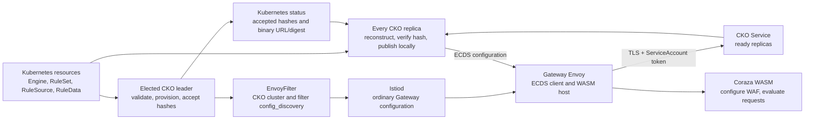
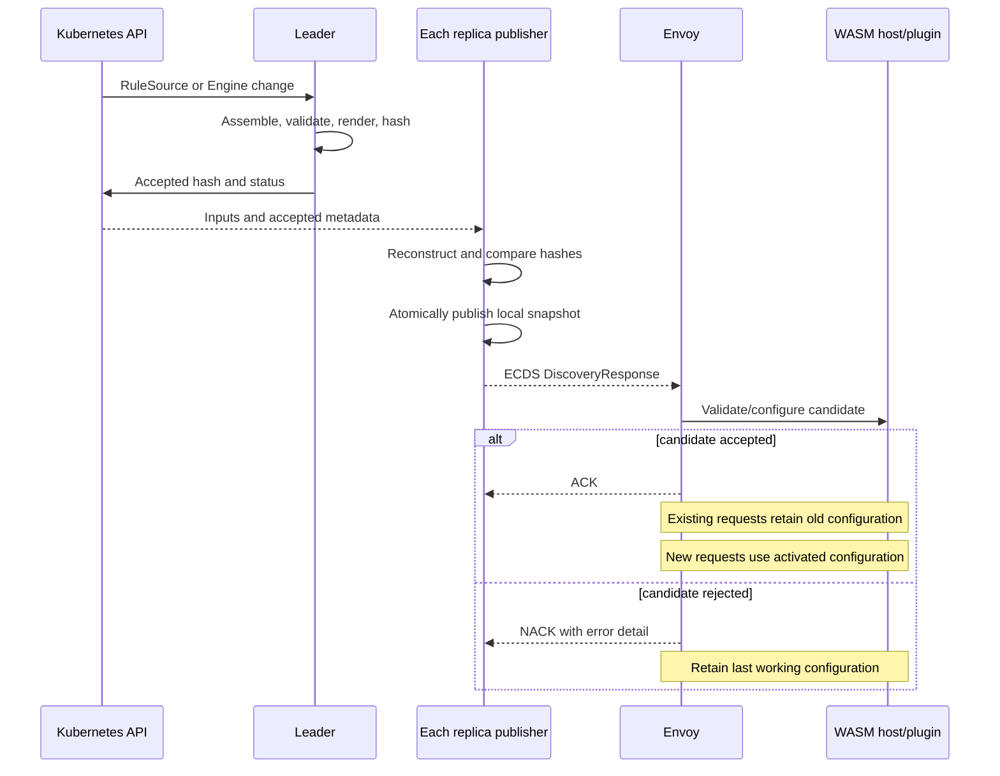
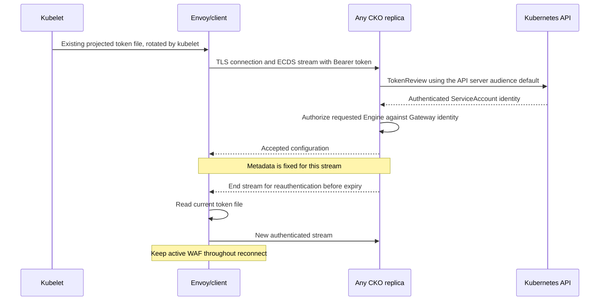
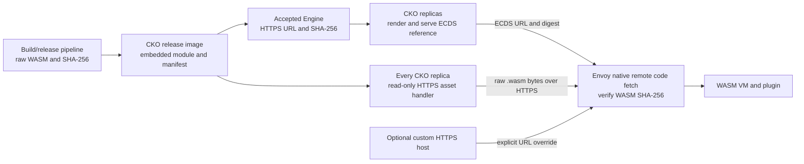
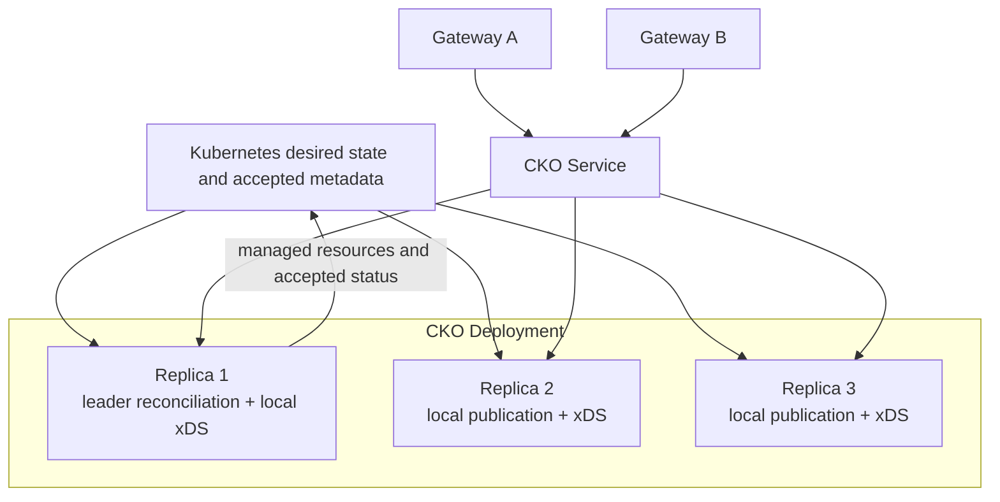
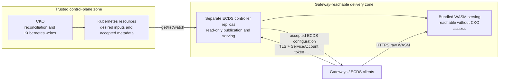

# Native ECDS distribution for Coraza configuration

- **Status:** architectural proposal for peer review; not merged or released. An unmerged ECDS MVP informs the refinements below, but is not functionality delivered on `main`.
- **Scope:** Coraza Kubernetes Operator (CKO), coraza-proxy-wasm, and their Istio integration.
- **Baseline inspected:** CKO commit `38b5b06`, upstream Istio 1.30.3, and OpenShift cluster-ingress-operator commit `286c3a6fd1b6b2b7edd990fa5a1fe5ea5507c1bf` with Istio 1.30.4 templates.
- **Date:** 2026-10-23; revised 2026-10-27 against the agreed MVP scope and unmerged prototype.

This document defines the intended behavior and the contracts needed to implement it. It is not an ordered implementation plan. Decisions agreed during architecture discussion are distinguished from proposed engineering details and integration checks that belong to implementation.

The prototype reviewed for this revision is `ecds/mvp` at `5de300a` ([fork PR #3](https://github.com/rikatz/coraza-kubernetes-operator/pull/3)), with the local companion plugin at `31bca96`. References to prototype evidence do not assert a released artifact, full platform support, or completion of the acceptance scenarios. The [MVP boundary](#mvp-boundary-and-follow-on-work) distinguishes the first delivery from later work.

For a first review, read the [decision record](#4-decision-record), [architecture](#6-architecture-and-ownership), [authentication](#10-authentication-authorization-and-transport), [binary delivery](#11-binary-delivery-without-gateway-customization), and [HA behavior](#14-high-availability-and-restart-behavior). The [examples](#16-examples) and [validation requirements](#19-validation-requirements-for-implementation) define the implementation-facing contract; [review focus](#22-review-focus) identifies the main tradeoffs. A [separate read-only ECDS controller](#21-future-decision-separate-read-only-ecds-controller) is a future deployment option, not part of this implementation scope.

## 1. Proposal

Use an Envoy Extension Config Discovery Service (ECDS), implemented with go-control-plane, instead of HTTP rule polling for the new delivery path. CKO assembles a complete configuration for each Engine and publishes it when its effective content changes. Envoy delivers that configuration through the Proxy-Wasm configuration lifecycle. Retain the HTTP rule server implementation, but do not start it or expose its rule endpoints. A future consumer may justify an enablement flag; that interface is a later decision.

One elected leader validates desired resources, manages Istio resources, and records accepted configuration hashes in Kubernetes status. Every CKO replica reconstructs and serves matching accepted configurations from its own memory. Gateway connections are authenticated with Kubernetes ServiceAccount tokens and authorized per Engine, independently of Istio workload certificates or a user-installed mesh.

Gateway pods remain unchanged. CKO uses EnvoyFilter directly to configure its upstream clusters and attach the ECDS-managed HTTP WASM filter. It creates neither WasmPlugin nor TrafficExtension resources. It must not add containers, mounts, image volumes, init containers, or Gateway infrastructure parameters, and must not trigger Gateway pod rollouts for rule, policy, credential, or binary changes.

The binary source is an HTTPS URL serving raw WASM bytes, paired with their SHA-256 digest. CKO bundles the default WASM module and an embedded asset manifest in its release image, then serves those immutable bytes to Gateways over HTTPS. This supports air-gapped deployments without a runtime download from an external artifact host. An explicit custom URL/digest pair may still point at another HTTPS host. CKO does not resolve OCI references, extract images, or proxy/cache arbitrary remote binaries.

## 2. Why change the current model?

In the pre-ECDS baseline inspected above, RuleSource and RuleData provide desired rule content. RuleSet reconciliation assembles and validates it, then places rule text and data files in a process-local HTTP cache. Engine reconciliation creates a WasmPlugin containing cache coordinates, an authentication token, polling settings, and Engine settings. The plugin polls for a revision and downloads changes before compiling a new WAF.

This spreads configuration delivery across the operator, an HTTP revision protocol, polling logic inside WASM, and WasmPlugin updates. Credential renewal also changes plugin configuration. The current cache is populated only by the leader, while the Service can route requests to replicas without that state. The chart therefore explicitly does not support HA.

ECDS moves subscription, reconnect, configuration delivery, and acknowledgement into Envoy's native control-plane protocol. The expected benefits are:

- Event-driven updates without a rule polling interval.
- No credential-driven WASM reconfiguration.
- A single complete Engine configuration, including its assembled rules and data files.
- Explicit ACK/NACK visibility, with no claim that an ACK proves continuing WAF health.
- Multiple CKO replicas serving configuration while one leader performs Kubernetes writes.
- An authentication contract usable by authorized Kubernetes clients beyond Istio.
- Less networking and update-management code inside the WASM plugin.

ECDS does not make delivery globally atomic, eliminate configuration caching, or automatically replicate CKO state. Those behaviors are specified below.

## 3. Goals and non-goals

### Goals

1. Deliver complete, validated Engine configurations over authenticated ECDS.
2. Update rules, RuleData, failure policy, and other runtime settings without restarting Gateway pods.
3. Preserve one configuration for the lifetime of an in-flight request; new requests use the activated configuration.
4. Preserve the last valid configuration during CKO outages and rejected updates.
5. Honor the Engine's failure policy before the first valid configuration arrives.
6. Support one leader for reconciliation and all replicas for xDS serving.
7. Authenticate with Kubernetes ServiceAccount tokens and authorize access to individual Engine configurations.
8. Support upstream Istio and OpenShift's dedicated Gateway Istiod without requiring a user mesh, subject to the token-source checks in [authentication](#10-authentication-authorization-and-transport).
9. Keep existing namespace isolation, validation, unsupported-rule policy, target conflict handling, and observability semantics.
10. Make all effective changes content-addressed and reproducible across replicas and restarts.
11. Serve the bundled default WASM module directly from CKO without external artifact access in air-gapped deployments.

### MVP boundary and follow-on work

The first delivery targets upstream Istio on KIND: complete rules and RuleData, deterministic accepted hashes, leader-only acceptance/provisioning, all-replica publication, authenticated and authorized ECDS, TLS, native bootstrap policy, and the bundled real WASM module. The prototype's recorded from-scratch demo used Istio 1.31.1; the original inspection used 1.30.3. Neither record establishes OpenShift compatibility or passes the entire validation campaign by implication.

The MVP keeps one complete inline configuration per Engine. Module bytes remain a remote HTTPS reference with SHA-256 verification, never inline ECDS bytes or Gateway-mounted files. The current plugin's versioned JSON and embedded-CRS filesystem behavior are temporary: the team intends to replace that plugin. Preserve the operator's assembly/acceptance and ECDS boundaries while allowing the plugin-specific payload and build dependency to change.

Custom external module-host trust/allowlists, multi-module release rollover, OpenShift service-serving certificates and proxy-image verification, HA chaos/soak hardening, and the full acceptance campaign are follow-on work. The all-replica architecture remains in scope; this cut does not turn a single-replica demo into a verified HA deployment. OLM packaging is outside this MVP. The separate serving deployment and incremental RuleData distribution remain future decisions in Sections 21 and 24.

Distinguish revised decisions from unfinished deployment profiles. Bounded readiness, hard-invalidation handling, recovery versions and acceptance-gated bootstrap sequencing below supersede the original stronger guarantees in response to MVP findings; they are not promises to restore those guarantees later. Conversely, the legacy-image preflight/tombstones and certificate reuse are not present in the reviewed prototype, and custom URL/digest fields lack the complete external-host policy. Keep those as follow-on gaps before claiming the corresponding upgrade, release-rollover, or external-host support, not new blockers to merging the development MVP. See [follow-on work](#follow-on-work-and-deferred-prototype-findings) for next steps; merging the MVP and closing the recorded five review findings are separate work items.

### Non-goals

- An active HTTP rule delivery mode, its enablement flag, a migration bridge, or rolling compatibility with the old polling plugin in this work. Preserve the HTTP server code disabled; decide its future activation contract when a consumer needs it.
- Gateway Deployment customization, added sidecars, init containers, image volumes, or use of Gateway.spec.infrastructure.
- Creating or depending on WasmPlugin or TrafficExtension resources in the proposed model.
- OCI resolution/translation, registry authentication, archive extraction, or on-demand remote binary proxying/caching inside CKO. Serving the bundled immutable WASM module is in scope.
- An Istio agent companion in CKO for client authentication.
- Replacing Istiod or proxying its ADS connection; CKO serves its own ECDS endpoint only.
- Globally simultaneous updates across workers, pods, or Gateways.
- Mutating an in-flight transaction to use a different ruleset.
- Persisting historical accepted rule payloads in a new CRD, ConfigMap, database, or PVC.
- Automatically rolling back a globally accepted configuration because one proxy NACKs it.
- New WAF drivers, arbitrary gateway-provider integration, packaged rules, or cross-namespace rule references.
- A pluggable artifact service, custom Envoy build, custom authentication agent, or custom proxy extension as an assumed prerequisite.
- Deploying the ECDS server as a separate controller now; that is a documented future architecture decision.

## 4. Decision record

| Topic | Agreed decision |
| --- | --- |
| Runtime configuration | Rules, data files, failure policy, and other runtime Engine settings travel through ECDS. |
| Request lifetime | Existing requests finish under their original configuration. |
| Convergence | Different workers and Gateway replicas may briefly enforce different valid versions; document and observe this caveat. |
| CKO outage or invalid replacement | Continue enforcing the last accepted configuration indefinitely while its process retains it. |
| Initial startup | Explicit fail-open allows traffic without an initial valid configuration; the default remains fail-closed. |
| Invalid or missing rule references | Reject the replacement and mark desired state degraded. Established proxies retain their WAF; retention of a distributable accepted record has the hard-invalidation exceptions in Section 7. Deleting the Engine deliberately detaches its WAF. |
| Persistence | Historical payloads remain in process memory. Accepted hashes in Kubernetes do not constitute a historical payload store. |
| Ready | Preserve acceptance/provisioning semantics, not proxy ACK or runtime health. Delivery diagnostics remain separate; an Engine-visible NACK signal is deferred follow-on work. |
| Istio attachment | EnvoyFilter directly configures CKO upstream clusters and ECDS filter attachment; no WasmPlugin or TrafficExtension resources. |
| HTTP rule server | Keep its implementation, token helpers and prerequisite code disabled, with no active rule endpoints. Retain `spec.ruleSetCacheServer` unchanged but ignored. Decide a future enablement flag/contract when needed. |
| Binary delivery | CKO bundles and serves the default raw WASM module plus an asset manifest for air-gapped use; Envoy downloads by HTTPS and verifies SHA-256. Custom URL/digest pairs remain possible. |
| Gateway modification | EnvoyFilter-based proxy configuration only; no pod-template customization or pod rollouts, including for binary updates. |
| Authentication | Kubernetes ServiceAccount tokens validated with TokenReview, replacing the proposed Istio certificate companion model. |
| Authorization | A ServiceAccount may consume configurations only for Engines targeting Gateways using that identity. Shared ServiceAccounts share access. |
| Platform scope | One protocol/authentication model; upstream Istio is the MVP validation target. OpenShift image capability and integration verification are post-MVP. |
| HA | One leader reconciles; every replica serves accepted configuration. This supersedes the earlier single-replica proposal. |
| Cold readiness | Bound initial reconstruction waiting rather than allowing one unreconstructable Engine to keep every replica unready indefinitely. Report unavailable Engines; Ready does not guarantee identical snapshots. |
| NACK recovery | Permit bounded derived wire versions and VM IDs to overcome Envoy's rejected-config cache. Keep the accepted content hash unchanged; stop on exhaustion. |
| Bootstrap sequencing | Gate weakening on a matching accepted record, not on proxy ACKs or fleet activation. After attachment convergence, explicit fail-open can allow traffic while ECDS is unavailable. |
| API migration | Breaking change within `waf.k8s.coraza.io/v1alpha1`; no new API version or conversion webhook. Reject legacy image requests explicitly, rather than silently selecting the bundled module. |
| Empty rules | `RuleSet.spec.emptyRulesPolicy`: `Reject` by default, `Allow` only as an explicit no-op opt-in. Empty content is not missing content. |
| Transport and trust | One TLS listener with ALPN and HTTP/gRPC request dispatch. Use a Helm-managed or supplied certificate Secret and inject the public CA through Envoy configuration; no Gateway volume. |
| Plugin replacement | The current consumer and its JSON/CRS-alias details are temporary. Keep plugin replacement separate from operator-side acceptance and ECDS transport. |
| Future deployment split | A separate read-only ECDS controller is an alternative for later security/placement decisions, not a current implementation goal. |
| Remaining integration details | Verify during implementation; revisit a decision only when a concrete limitation requires it. |

## 5. Terms

| Term | Meaning |
| --- | --- |
| Desired configuration | The current Engine, RuleSet, RuleSource, and RuleData contents in Kubernetes. |
| Accepted RuleSet | Exact assembled rule text and data bytes successfully validated by the leader. |
| Engine configuration | Complete effective settings and accepted rule content for one Engine, plus its binary reference. |
| Accepted configuration | An Engine configuration whose content hash the leader has recorded after validation and provisioning. |
| Local snapshot | An immutable accepted configuration held by one CKO replica. |
| Active configuration | The configuration a particular Envoy worker is using. It may lag the latest accepted configuration. |
| Last-known-good configuration | The most recent successfully retained configuration in a CKO replica or Envoy process. It is not a durable revision history. |
| Binary digest | The SHA-256 of the exact raw WASM bytes fetched by Envoy. |
| Embedded WASM bundle | Raw WASM release bytes and a manifest packaged with CKO. It contains no Engine rules, RuleData, or credentials. |
| Accepted content version | The deterministic hash of a complete effective Engine configuration. It is distinct from Kubernetes resourceVersion and an xDS response nonce. |
| Recovery version | A bounded, derived ECDS wire version used to retry a rejected configuration. It does not approve new content or change the accepted hash in Kubernetes. |

## 6. Architecture and ownership



| Responsibility | Owner |
| --- | --- |
| Kubernetes resource validation and status writes | Leader reconcilers |
| Rule ordering, data merging, aggregate Coraza validation | Existing RuleSet path, refactored around a reusable assembler |
| Effective Engine configuration and canonical hashes | Shared deterministic rendering module |
| Accepted-hash publication | Leader only |
| Local snapshots, watches, subscriptions, ACK/NACK accounting | Each replica's xDS publication/server module |
| Default WASM packaging | Build/release pipeline embeds raw module bytes and their manifest into the CKO release image |
| Bundled WASM availability | Read-only HTTPS asset handler on every serving CKO replica |
| Optional custom WASM availability | The configured HTTPS host, independent of CKO's embedded assets |
| Binary download, digest verification, and code caching | Envoy native remote code loader |
| Ordinary Gateway deployment and routing | Istio/OpenShift platform |
| CKO-specific upstream connections and HTTP filter attachment | Leader-managed EnvoyFilter |
| Token validation and Engine authorization | Every serving CKO replica |
| WAF creation and per-request transactions | Coraza WASM plugin |
| Existing central ALS collectors and provider configuration | Platform, as today |

Keep the assembler/renderer independent of Kubernetes writes and network serving. Both leader validation and replica publication must use the same rules for assembling content. Replicas must not reimplement a second, slightly different renderer.

## 7. Configuration identity, content, and hashing

### Resource identity

Use one stable ECDS resource name per Engine instance:

```text
coraza.waf.<namespace>.<engine-name>.<engine-uid>
```

This is an opaque Envoy resource identifier, not a Kubernetes object name. Names of generated Kubernetes resources remain bounded and collision-resistant. Including Engine UID prevents a deleted Engine's cached configuration from being mistaken for a recreated Engine with the same namespace/name. A RuleSet shared by several Engines produces separate Engine resources, because their policies, identities, binary versions, and observability settings can differ.

### Payload

The resource is a full envoy.config.core.v3.TypedExtensionConfig. Its typed_config is envoy.extensions.filters.http.wasm.v3.Wasm. The nested PluginConfig includes VM/code information, the native WASM failure policy, and JSON runtime configuration. ECDS supplies the complete native filter configuration for the EnvoyFilter attachment. See [Envoy's WASM interface][wasm-proto].

The MVP JSON schema for the current ECDS-aware plugin is versioned and self-contained. It is a consumer contract, not a permanent cross-plugin API; replacing the plugin may change this encoding without changing Kubernetes rule inputs or the ECDS acceptance model:

```json
{
  "schema_version": 1,
  "engine": "checkout",
  "namespace": "shop",
  "engine_uid": "11111111-1111-4111-8111-111111111111",
  "driver_type": "wasm",
  "empty_rules_policy": "Reject",
  "failure_policy": "fail",
  "enable_filter_state_logs": true,
  "rules": "SecRuleEngine On\nSecRule ARGS \"@contains attack\" \"id:1001,phase:2,deny,status:403\"",
  "data_files": {
    "blocked.txt": "YXR0YWNrCg=="
  }
}
```

Data values are base64-encoded bytes in JSON, matching Go's encoding of byte slices. Preserve the existing RuleSource order, RuleData merge behavior, filename validation, and complete RuleSet validation. Source-level validation opt-outs do not bypass aggregate validation. Validate with an in-memory filesystem, not the operator host filesystem; reject unsupported host-writing directives and references the consumer cannot resolve. Consumer-specific embedded aliases require explicit validation and conformance checks, not an assumption that the operator and plugin embed identical files or Coraza versions.

Bound decoded data, file count and encoded message size, accounting for base64 expansion, escaped keys and the ECDS envelope. Reject an undeliverable configuration before Engine acceptance, not only when publishing. Recheck limits on publication and validate installation limits against consumer caps at startup. The reviewed prototype uses a 16 MiB message limit, 8 MiB decoded-data default and 4096 files; these are sizing evidence, not permanent API guarantees. Reject empty assembled rules by default; `empty_rules_policy: Allow` explicitly permits a no-op WAF and must not be inferred from missing inputs.

Runtime JSON contains no token, token file contents, polling interval, HTTP rule-server address, or per-pod connection identifier. A reconnect does not change it.

### Hashes

Define a versioned canonical serialization of logical content, with deterministic map-key ordering and explicit default values:

```text
ruleSetHash = SHA256(canonical(rule text + data filenames and bytes))
engineVersion = SHA256(canonical(complete effective Engine configuration))
```

The Engine configuration includes Engine identity, RuleSet content, failure policy, observability settings, the WASM byte digest, code location, VM settings, and a rendering-schema version. It excludes response nonces, status timestamps, Kubernetes resourceVersion, credentials, and replica identity. The version itself is outside the content being hashed, avoiding a recursive hash definition.

Use `sha256:<64 hexadecimal characters>` for the accepted content version. Reverting exactly to an older effective configuration may reproduce its older version; xDS versions are opaque, not monotonic counters. Rule text is byte-sensitive: changing whitespace or comments can change the version. Metadata unrelated to effective behavior must not. The bounded recovery exception in Section 9 may derive a wire version and VM ID without changing this accepted content identity.

The binary SHA-256 identifies the raw response bytes, not a compressed archive or container manifest. CKO includes the supplied digest in the resource; Envoy verifies downloaded bytes against it. CKO validation of a reference does not assert that its remote content is available or correct.

### Accepted status metadata

Add accepted-content metadata to existing statuses, without a new revision CRD. Exact Go field layout is an implementation detail; the following information is required:

| Resource | Required information |
| --- | --- |
| RuleSet | Accepted assembled-content hash and the generation at which it was accepted |
| Engine | Accepted complete-resource version, accepted RuleSet UID/hash, accepted Engine generation, rendering-schema version, binary HTTPS URL, raw WASM digest, and effective failure policy |

These records contain identifiers and effective settings, not rules, data files, credentials, or compiled WAF objects. Preserve the previous accepted record during ordinary wait states, while updating conditions to describe the failure. Clear an unjustified Engine record on a missing/recreated RuleSet, content rejected as invalid by the current validator, definitive missing inputs encountered during Engine assembly, or delivery-limit rejection. A missing dependency may first be observed as a RuleSet wait/degraded state that retains the record; it does not imply universal immediate clearing.

Clearing a record withdraws the replica's distributable snapshot; it is not remote erasure of an already active proxy WAF and must not send an empty successful ECDS response. A fresh proxy may then have only its attachment's bootstrap policy until acceptance recovers. Do not claim historical-config availability or guaranteed fail-closed behavior merely because the record was cleared: bootstrap depends on the delivered attachment and chosen failure policy.

**Ready alone never authorizes publication.** A referenced RuleSource can change without incrementing its RuleSet's generation. Each serving replica must reconstruct the exact bytes and compare their hash with the accepted record before publishing. The Engine record must also match its complete reconstructed configuration, so policy-only changes cannot escape the gate.

## 8. Leader acceptance and replica publication

### Leader path

1. Observe desired inputs and enforce current target-conflict and namespace rules.
2. Assemble and validate the RuleSet, including data dependencies and unsupported-rule policy.
3. Validate the effective binary HTTPS URL and SHA-256 syntax. When the Engine omits them, select the default from CKO's verified embedded manifest and its advertised asset URL. Do not fetch a remote binary during reconciliation; Envoy verifies downloaded bytes. CKO verifies its own bundled bytes against their manifest at startup.
4. Construct and validate the effective Engine configuration, including delivery limits, and compute its version. A rendered candidate must not be served as accepted before its accepted metadata is published.
5. Recheck input identities/versions before acceptance. If inputs changed during assembly, retry; do not approve a stale mixed read.
6. Apply the NetworkPolicy before the EnvoyFilter; optional Telemetry failure must not block WAF provisioning. The bootstrap attachment must honor the stricter of its current and requested policy: tighten immediately, and defer weakening until the new configuration has an accepted record.
7. Publish accepted metadata and the corresponding conditions atomically within each status patch. RuleSet acceptance precedes Engine acceptance. Mark Engine Ready only after the local candidate is prepared and attachment is provisioned.
8. Publish through the same reconstruction/hash gate on the leader and all other replicas. Ready describes accepted/provisioned state; local serving follows acceptance and replicas may lag. It does not wait for a proxy ACK, nor does acceptance prove proxy activation.

The implementation must account for a leader crash between these operations. Partial progress must result in bootstrap behavior or continued last-known-good enforcement, never an unvalidated publication. No global transaction across several Kubernetes objects is assumed.

Attachment changes applied in Step 6 are safe before Step 7 because they carry no payload. The EnvoyFilter references the ECDS resource by name and type, names the Engine-instance resource, and sets the bootstrap policy; it never embeds rules, data, credentials, or binary bytes. Envoy can connect before acceptance but receives no resource until Step 7 publishes the accepted record and a replica passes the hash gate. A crash or failure between Steps 6 and 8 therefore leaves the attachment pointing at CKO with bootstrap or last-known-good behavior, never at an unaccepted candidate.

Generated attachment resources carry a content annotation derived from the candidate's version and bootstrap policy, so a new leader or a restarted process re-derives and reapplies the same or a newer attachment idempotently; a superseded attachment has no payload to roll back. If inputs change before acceptance, the next reconcile recomputes the attachment from accepted state and reapplies it. The explicit bootstrap-policy exception still applies while ECDS has never been reachable: the attachment's minimal allow/deny default governs traffic until the first accepted resource arrives.

### Every-replica path

Each replica runs read-only publication watches and its xDS server independently of leader election. It watches Engine status/spec, RuleSet status/spec, referenced RuleSources/RuleData, and the Gateway/Pod/ServiceAccount information needed for authorization.

For an accepted Engine record:

1. Read the current inputs and accepted binary URL/digest. For an omitted user override, reconstruct the accepted resolved pair from status, rather than substituting a different local release default before the leader accepts it.
2. Assemble the canonical content and render the complete resource.
3. Compare all hashes and identities with the accepted record.
4. If they match, replace the local snapshot atomically and notify affected subscriptions only if its version changed.
5. If they do not match, retain the previous local snapshot and wait for the next relevant event. Do not publish current desired content merely because a Ready condition remains true.

Informers may observe status before input changes, or input changes before status. Hash mismatch is an expected temporary state. Coalesce work by Engine key, bound concurrent assembly, and skip reassembly when the relevant input fingerprints are unchanged.

Only the leader writes desired-status results or extension resources. Followers can perform local parsing and reference validation, but must not independently approve configurations or contend on status updates. If local validation rejects leader-approved content, retain the previous snapshot and report the discrepancy.



## 9. ECDS protocol contract

Use the Envoy v3 ExtensionConfigDiscoveryService from go-control-plane. The proposed first wire profile is streaming state-of-the-world ECDS, scoped to one Engine resource per subscription stream. Delta ECDS and ADS multiplexing are not required. Verify the exact subscription behavior against target Envoy builds before fixing the server cache/watch implementation.

| Item | Contract |
| --- | --- |
| RPC | envoy.service.extension.v3.ExtensionConfigDiscoveryService/StreamExtensionConfigs |
| Resource type URL | type.googleapis.com/envoy.config.core.v3.TypedExtensionConfig |
| Nested filter type URL | type.googleapis.com/envoy.extensions.filters.http.wasm.v3.Wasm |
| Subscription | Explicit Engine-instance resource name; no unrestricted wildcard access |
| Version | Accepted content hash; bounded derived recovery versions as described below |
| Nonce | Response/stream correlation only; may differ across replicas |
| ACK/NACK | Correlated to the response nonce and the client's reported accepted version/error |
| Reconnect | Reauthenticate, reauthorize, establish a new subscription, and reconcile client/server versions |

Authorization must precede any cache lookup that can return payload content. Do not trust node.id, node metadata, a caller-selected snapshot key, or the requested resource name as identity. Any go-control-plane NodeHash/cache adapter must be scoped through the authenticated and authorized stream context, not through an unverified node identifier alone.

ACK-only requests may omit fields; use the established stream's subscription state. Subscription changes require authorization again. Unsupported wildcard or multi-resource subscriptions must fail explicitly, rather than accidentally expose a tenant-wide cache. If Envoy groups resources in a way that conflicts with this profile, adapt the standard subscription handling and document the tested behavior; do not work around it by disabling authorization.

Do not send an empty successful response to represent invalid desired state, a missing local reconstruction, or a temporary cache miss: omission can be interpreted as resource removal. A known authorized resource that cannot currently be reconstructed should retain its established snapshot, wait for availability, or return an appropriate retryable stream error. An unknown or unauthorized Engine must not leak its content or existence through detailed errors.

A NACK must not approve new content, roll back other proxies, or trigger an unbounded republish loop. Ordinary reconnects retain the same version and should not rebuild an unchanged effective resource. Cold remote-module startup needs a specific exception: target Envoy behavior can remember a rejected typed-config hash, so reconnecting or resending only the same version does not reliably retry it.

Permit a bounded recovery attempt that derives both an ECDS wire version and VM ID from the accepted resource, leaving rules, data, policy and binary reference unchanged. The reviewed MVP uses `<accepted-version>.retryN` and a corresponding VM-ID suffix, bounded by a 20-second window and 10 attempts; an ACK clears the budget. These are recovery identities, not new leader acceptance or an alteration of the status hash. Expose exhaustion, stop retrying, and preserve last-known-good or bootstrap behavior. This deliberately relaxes the original same-version-only retry assumption, not the hash gate. An ACK remains protocol acceptance, not proof that every worker is healthy or traffic was evaluated successfully.

Set explicit limits for message size, decoded data, subscriptions per identity, concurrent streams, pending watches, and queued updates. The supported RuleSet envelope must fit the chosen limits; do not inherit an accidental default that rejects the project's full CRS scenario. These values and retry timers belong to implementation measurements, not new Engine polling options.

## 10. Authentication, authorization, and transport

### ServiceAccount authentication

The client reads the existing Kubernetes ServiceAccount token at `/var/run/secrets/kubernetes.io/serviceaccount/token` and presents it in gRPC authorization metadata. Every CKO replica validates it using TokenReview and derives identity from the validated result, including ServiceAccount namespace/name and UID where available. The authenticated identity is scoped to CKO's configured Kubernetes API server; client claims do not select a different cluster or issuer.

The existing TokenAuthenticator is a useful starting point, not an unchanged security contract: the new path must check the returned authenticated identity and audience result, cap authentication-cache lifetime at token expiry, and adapt it to streaming RPCs. A successful base64/JWT decode is not authentication. Kubernetes recommends TokenReview for validating these credentials and their bound-object validity. See [Kubernetes ServiceAccounts][service-accounts] and [TokenReview][token-review].



No token value is stored in Engine status, an EnvoyFilter, an ECDS payload, logs, metrics, or a binary URL. Token rotation must not change the effective configuration hash or require a WASM reload.

### Audience and existing mounts

The default policy deliberately accepts the existing Kubernetes API audience token. CKO omits TokenReview.spec.audiences so Kubernetes validates against its API server audience; this uses the documented audience default, rather than disabling audience validation. Do not infer accepted audiences from an unverified JWT. If a deployment explicitly selects another audience, require a matching validated TokenReview.status.audiences result.

Consequently, an authenticated TokenReview response with an empty `status.audiences` is accepted only for the default API-server audience. When CKO configures an explicit audience, an empty or non-matching `status.audiences` is rejected. Tests must cover a matching audience, a non-matching audience, and an empty result for both configurations. See [TokenReview][token-review].

Live inspection of both pods for the OpenShift Gateway `openshift-ingress/waf-telemetry` confirmed the standard token mount in `istio-proxy`, using ServiceAccount `openshift-ingress/waf-telemetry-openshift-default`. Its kube-api-access projected volume contains the token without a custom audience. The separate `/var/run/secrets/tokens/istio-token` projection, with audience `istio-ca`, is also present but is unnecessary for CKO. Inspecting only the Istio template had omitted the standard Kubernetes admission-provided mount.

Reusing the standard token means CKO accepts a credential also valid for the Kubernetes API; per-Engine authorization remains mandatory. No dedicated token projection or Istio agent is required.

Support for a Gateway image is conditional on this inspection: the image must expose the standard projected token readably, with an audience CKO explicitly accepts, without Gateway template or mount changes. The inspected OpenShift Gateway meets the token-mount condition, but this alone does not verify its ECDS credential extensions. The unmerged upstream Istio prototype provides evidence for the selected mechanism below; OpenShift's complete proxy-image verification remains post-MVP. If another supported Gateway lacks a suitable existing token, report that concrete incompatibility during implementation; do not silently edit its pod template or fall back to anonymous access.

### Reading and renewing the token

The required client behavior is to read the current file for each new RPC/stream and handle Kubernetes projected-volume rotation. A token path placed in initial_metadata is just a string; it does not read the file.

Select Google gRPC with file-based metadata credentials for the MVP, using `credentials_factory_name: envoy.grpc_credentials.file_based_metadata` and the corresponding `from_plugin` call credentials. The factory setting is required: the default credentials factory can ignore the file-based call credentials. Google gRPC connects directly to the advertised CKO address with explicit CA trust; it does not require an Envoy-managed ECDS cluster. The binary fetch still uses a separate Envoy cluster without credentials.

Native `envoy_grpc` plus an upstream credential injector is an alternative only if a target image proves Google gRPC unavailable. It would need a complete mount-free credential path and an ECDS cluster; it is not a second MVP backend or an assumed fallback. See [GrpcService][grpc-service], [file-based metadata credentials][file-credentials], and [generic credential injection][generic-credentials].

Authentication metadata cannot be replaced on an already open stream. CKO must end or reauthenticate streams before the presented token expires, with bounded lifetime and jitter to avoid synchronized reconnects. Reauthorize subscription changes and changes to the Engine/Gateway identity mapping. Bounded TokenReview revalidation must also cover idle long-lived streams; transport keepalive alone is not reauthentication. TokenReview unavailability must not grant a new identity access. Existing Envoy configuration continues to enforce while reconnection is retried.

If bounded revalidation of an open stream cannot complete within its window, CKO ends that stream. The cached WAF keeps enforcing, the client must reconnect and reauthenticate, and the ended stream receives no further updates. TokenReview unavailability never keeps an unverified stream authorized.

### Per-Engine authorization

Authentication establishes a ServiceAccount, not an Engine, Gateway name, or permission to read every ruleset in its namespace. For each requested Engine, CKO must verify:

1. The Engine UID matches the requested resource and the Engine is not deleting or rejected because of target conflict.
2. The target Gateway exists and belongs to the Engine namespace under existing targeting rules.
3. The verified ServiceAccount identity is one used by the target Gateway's actual workload, derived from controller-observed Gateway/Pod/ServiceAccount state.
4. The Engine's accepted resource is the only content returned for this subscription.

Preserve the currently accepted target's authorization while rule input becomes degraded; that is necessary to serve last-known-good content. Deliberately deleting an Engine or removing/rebinding the authorized workload identity revokes subscriptions, including existing streams. Do not wait until a new connection to notice revocation. During an observed workload transition, any permitted overlap of old/new identities must be bounded by the actual live workload mapping.

Authorization mappings have a bounded freshness period, aligned with the TokenReview revalidation window. Each revalidation refreshes the Engine, Gateway, Pod, and ServiceAccount mapping from the replica's informer state; if the informer has not synchronized or the mapping cannot be refreshed within that bound, for example during an API/watch partition, the affected streams end and new subscriptions are rejected until freshness is re-established. A stale mapping must not keep authorizing a deleted Engine or a rebound Gateway indefinitely.

Workloads using the same ServiceAccount share that authentication identity and consequently its permitted Engine access. Namespace/name fields claimed by an xDS node cannot provide finer isolation. This is an explicit caveat, not a reason to trust self-reported proxy metadata.

### Server TLS

ServiceAccount tokens authenticate clients; ordinary server TLS protects the token and authenticates CKO. No client certificate or Istio mTLS is required by this contract.

Use a Helm-managed CA and serving-certificate Secret, or a supplied Secret containing `ca.crt`, `tls.crt` and `tls.key`. Certificates must include the advertised operator Service DNS names. Reuse generated material across Helm upgrades rather than rotating the CA as a side effect of rendering the chart. OpenShift service-serving certificates are an optional post-MVP installation profile, not an MVP prerequisite.

CKO mounts its own Secret; Gateway pods remain unchanged. The leader's attachment provisioning reads the public CA from installation configuration and injects it into Google gRPC SSL credentials and the binary-fetch cluster's TLS context. Verify the advertised server name as well as the certificate chain; never use insecure-skip-verification. CA and token material stay outside the Engine runtime payload and accepted-content hash.

CA rotation must establish overlapping trust in Envoy before replacing the serving certificate, verify existing streams, reconnects and new connections, then retire the old root. Serving-leaf reload alone does not implement that sequence. The reviewed prototype loads the attachment CA at startup and the chart regenerates its default certificate material, so Secret reuse and coordinated trust refresh remain follow-on work; do not claim seamless CA rotation. Watch/reconcile ownership for live CA refresh must be specified and validated before that support is advertised. A trust update may reconnect ECDS but must not reload an otherwise unchanged WAF.

## 11. Binary delivery without Gateway customization

### Why not a binary-only WasmPlugin?

The original idea kept WasmPlugin solely for OCI download and pointed another ECDS subscription at CKO. The inspected Istio implementation does not provide that split: istio-agent intercepts Istiod's ECDS response, downloads OCI content, and rewrites its code reference to a local filename. A direct CKO ECDS stream bypasses this conversion. In the inspected release, EnvoyFilter EXTENSION_CONFIG processing also does not provide a supported merge/replace operation over WasmPlugin's generated resource. See [Istio conversion][istio-conversion] and [extension patch handling][istio-extension-patch].

The proposal therefore uses EnvoyFilter directly. CKO supplies the binary URL/digest in ECDS, and Envoy retrieves raw WASM from CKO's bundled asset endpoint by default or an explicitly configured HTTPS host. It must not depend on an undocumented Istio cache filename, attach the same WAF twice, or assume matching names merge resources from two control planes. TrafficExtension is not part of this model either.

### Selected path: bundled default WASM served by CKO



Replace Engine.spec.driver.wasm.image and imagePullSecret with a paired HTTPS URL and raw-byte SHA-256, proposed as Engine.spec.driver.wasm.url and Engine.spec.driver.wasm.sha256. An Engine omitting both uses the bundled module identified by CKO's embedded manifest and the corresponding operator-Service HTTPS URL. If either override is supplied, both are required. Replicas render the same accepted resolved pair.

The release packages both the actual raw WASM bytes and a small manifest containing the module's version, asset filename and SHA-256. A manifest containing only a remote reference would not satisfy the air-gapped requirement. The packaging mechanism may use Go embedding or immutable assets in the operator image; it must not fetch or unpack an OCI image at runtime. The manifest is release metadata, not a Gateway-mounted ConfigMap or a store of WAF rules. Commit a minimal valid empty WASM fixture for developer builds/tests, but replace it and its manifest with the real consumer module for a demo or release; the fixture is not a WAF.

An illustrative single-module MVP manifest is:

```yaml
schema_version: 1
module: coraza-waf-1.0.0
file: plugin.wasm
sha256: cccccccccccccccccccccccccccccccccccccccccccccccccccccccccccccccc
```

Every replica verifies its bundled files against the manifest before becoming serving-ready. The leader uses the manifest to select the default pair; followers use the accepted pair recorded in status. Serve the immutable bytes from a digest-addressed path, for example:

```text
GET https://<cko-service>:18080/wasm/<64-hex-sha256>.wasm
```

Use one TLS Service/listener for ECDS and bundled assets, with ALPN for HTTP/2 and HTTP/1.1. HTTP/2 request dispatch must distinguish gRPC from ordinary asset requests: `/wasm/<digest>.wasm` must work over both HTTP versions, rather than routing every HTTP/2 request to gRPC. A separate binary listener is not required. A binary request returns raw module bytes with application/wasm content, not a manifest, archive, redirect, or generated rule payload. Allow only packaged manifest entries; no uploads, directory listing, arbitrary filesystem access, or remote-fetch fallback. Do not inline module bytes into ECDS resources.

Bundled release WASM is a non-secret artifact. Its read-only route does not require an ECDS ServiceAccount bearer token; ECDS and rule content remain authenticated and authorized. Use TLS verification and the existing network-access policy. Keep binary requests in a distinct upstream cluster without ECDS credential injection, even when both clusters target the same CKO Service. Disabling the legacy HTTP rule server must not disable this separate asset route or expose /rules endpoints.

No registry credentials, OCI resolution/extraction, dynamic binary cache, external artifact proxy, or persistent binary volume is introduced in CKO. The packaged module is available after CKO restarts without reaching an artifact host. Gateways use Envoy's native download, code-cache and warming behavior, verifying the raw-byte digest provided through ECDS.

For HA and release rollover, ready replicas must serve the bundled digests referenced by active accepted configurations. Release packaging may need to carry overlapping module versions, and a new bundled default must not be promoted while ready backends cannot supply it. Multi-module overlap and mixed-release rollover are post-MVP; the MVP bundles one default module and must not imply that it supplies this guarantee for arbitrary mixed-version upgrades. This is binary release packaging, not durable storage of historical Engine rules.

Envoy's RemoteDataSource supports an HTTP code location and SHA-256 verification; raw WASM bytes, not an OCI manifest or tar layer, must be returned. See [RemoteDataSource][remote-code]. Stable VM identity, URI, and byte digest let rule-only updates reuse code. Binary changes update the ECDS code reference and use native fetch/warming; they must not change the Gateway pod template.

### Optional external/custom binary URL

This is a post-MVP deployment profile. Presence of URL/digest fields in a prototype does not establish support for arbitrary external hosts. Complete the explicit CA trust and destination-policy requirements before advertising this profile; never assume system trust roots or forward ECDS credentials.

An explicit URL/digest pair may target another raw HTTPS artifact host, for example https://wasm.example.net/coraza-proxy-wasm/v1.0.0/plugin.wasm. This is an override, not a requirement for the air-gapped default. Publish and test actual raw artifact URLs in the release workflow; do not assume a release-page link or redirecting URL works in the target fetcher.

Validate scheme, authority and digest before rendering clusters, and reject URLs containing userinfo, a query, or a fragment before accepting them or rendering the ECDS `http_uri`. Restrict this Gateway-initiated fetch to an operator-controlled host allowlist: deny private, link-local, and cluster-internal destinations, and deny redirects and DNS rebinding, unless platform egress policy provides equivalent controls. Add denied-target cases to the acceptance scenarios.

Do not embed credentials or short-lived signed tokens in the URL. The fetch carries no credentials, so an artifact host that requires authentication is out of scope and fails rather than falling back to anonymous or CKO credentials. CKO does not fetch, mirror or verify the remote bytes during reconciliation; Envoy performs content verification. Never forward CKO ServiceAccount credentials to an external host. Private binary-host authentication remains outside this first version.

## 12. Istio attachment and bootstrap

The leader creates a Gateway-scoped EnvoyFilter with the current derived workload selector and Istio revision targeting. This is the sole WAF attachment mechanism; CKO creates no WasmPlugin or TrafficExtension. The EnvoyFilter adds:

- A Google gRPC ECDS config source with the advertised CKO address, explicit server trust and file-based token credentials. No Envoy ECDS cluster is needed for this mechanism.
- A separate TLS binary-fetch cluster, targeting CKO's bundled asset route by default or an explicit custom host, with server trust and no ECDS ServiceAccount credential injection.
- One HTTP filter before envoy.filters.http.router, with config_discovery pointing to CKO and the Engine-instance resource name.
- A minimal bootstrap behavior reflecting Engine.failurePolicy.

The EnvoyFilter adds the binary-fetch cluster directly, with DNS resolution and explicit transport settings; Google gRPC handles its own ECDS connection. Neither path requires CKO-created ServiceEntry or DestinationRule resources. The old HTTP rule-server ServiceEntry and its TLS-disabled DestinationRule are not part of this path. See [EnvoyFilter cluster addition][envoy-filter]. Kubernetes NetworkPolicy and platform egress restrictions still apply; configuring an upstream does not grant network access.

Istiod remains responsible for normal Gateway configuration and delivers these attachment changes over its ordinary control plane. CKO must not replace the proxy's discovery address or own unrelated routing. Use one attachment owner per Engine and owner references for generated namespace-local resources.

Rule-only changes do not require changing the filter subscription or cluster configuration, although a candidate-version annotation may change. Token rotation does not modify the attachment. Failure-policy changes update the ECDS resource and the small bootstrap default, so a future cold start honors the policy even before ECDS is reachable. Those two changes converge asynchronously; existing requests retain their configuration.

Update order is part of the contract: never weaken the attachment's bootstrap default before the configuration carrying the new policy has an accepted record. During that acceptance window, retain the stricter bootstrap policy; then converge to the accepted policy. This is an acceptance gate, not a proxy-ACK or fleet-activation gate. If a proxy restarts before attachment convergence, it may temporarily use the stricter old bootstrap; after convergence, explicit fail-open applies even if ECDS is unreachable. Acceptance scenario 26 must cover both windows. Binary URL/digest changes update the ECDS code reference; a change to host, port, or trust also updates the binary upstream cluster. Neither change modifies the Gateway pod template or requires a rollout. Provision the required cluster before publishing a reference to it.

### Bootstrap has to work without a binary

An unreachable CKO must not make explicit fail-open impossible simply because no WASM bytes have been downloaded. The proposed bootstrap default is a small native HTTP RBAC configuration: the RBAC `rules.action` set to `DENY` with an empty `rules.policies` map allows traffic for fail-open, while `rules.action: ALLOW` with an empty `rules.policies` map denies it for fail-closed. Activate it without waiting for initial ECDS warming, then replace it with the WASM configuration when available.

This uses ExtensionConfigSource.default_config and apply_default_config_without_warming. The permitted type list contains both HTTP RBAC for bootstrap and HTTP WASM for the accepted resource. The server only publishes the accepted WASM type. Cross-factory replacement in the target builds must be verified; if it does not work, bring back a concrete alternative that preserves the required failure semantics and unchanged Gateway pods. See [ExtensionConfigSource][extension-source] and [HTTP RBAC][rbac].

The bootstrap deny response is proposed as native RBAC HTTP 403. Runtime VM failure may return Envoy's native failure status, and Coraza rule actions retain their configured status codes. The agreed failure-policy contract concerns allowing/blocking traffic, not identical response bodies or codes across these distinct causes. Document the final tested responses.

Before attachment has actually been delivered by Istiod, CKO cannot claim WAF enforcement. Provisioning conditions and operational documentation must distinguish resource creation from dataplane delivery.

## 13. WASM configuration lifecycle

Remove HTTP rule fetching, latest-version polling, cache tokens, and timer-driven reloads from the ECDS plugin path. On configuration, parse the complete JSON payload, decode the data files, create the rule-data filesystem, and build the WAF synchronously enough for invalid configuration to be rejected through the supported host lifecycle. Reuse current Coraza validation/filesystem/error-handling code where applicable.

The Proxy-Wasm callback is proxy_on_configure, mapped to OnPluginStart in the Go SDK used by the sibling plugin. A changed configuration may create a new root/plugin context while reusing a VM; do not assume the same Go object is mutated in place. Preserve host and WAF ownership until in-flight requests finish. See [SDK callback][sdk-configure] and [host plugin creation][host-configure].

Map Engine.failurePolicy consistently to the native WASM failure policy and the plugin's internal error handling. A candidate that cannot be parsed or compiled must not replace an established valid WAF with an empty or partly initialized one. Unknown schema versions must fail explicitly.

Per-worker activation and per-request configuration lifetime are the required guarantees. ACK/NACK does not substitute for live tests of asynchronous code download, worker startup, VM traps, retirement, or memory reclamation. Preserve current request/response inspection and central ALS fields, including engine, namespace, driver_type, and outcome/category data. No new per-request network operation is introduced.

## 14. High availability and restart behavior



All replicas maintain their own snapshots; Kubernetes stores desired inputs and accepted hashes, not a distributed go-control-plane cache. No direct replica-to-replica replication protocol is introduced. Followers' TokenReview requests are authentication operations, not competing reconciliation writes.

The serving process must start its publication, xDS and bundled-asset paths without waiting for leadership. Losing leadership stops reconciliation writes, not healthy established xDS streams or asset serving. Replica liveness means the process is functioning; serving readiness requires TLS/listeners, verified embedded assets and informer synchronization. Initial reconstruction of compatible accepted records gates readiness for a bounded window, not indefinitely: one tenant's permanently unreconstructable record must not remove every replica from the Service.

The MVP uses a two-minute reconstruction deadline, then reports the affected records through logs/metrics and permits the replica to serve the configurations it can reconstruct. Records from an incompatible rendering schema do not gate that startup window. This deliberately replaces the original indefinite cold-readiness rule. Ready is consequently not a claim of equivalent snapshots for every Engine, and deadline expiry neither authorizes a hash mismatch nor recovers missing historical bytes. It does not bypass asset verification or establish mixed-release digest availability.

An already ready replica retains its previous snapshot on reconstruction mismatch while the accepted record remains eligible. Hard invalidation/record clearing follows Section 7 and can withdraw that snapshot. A cold replacement cannot serve bytes it never reconstructed, even after its readiness deadline. Existing proxies may still retain their WAF; a fresh proxy follows its delivered bootstrap policy. Expose this per-Engine availability limit instead of claiming that all invalid/missing inputs preserve historical distribution.

When an xDS-serving replica disappears, Envoy keeps its active configuration and reconnects through the Service to another ready replica. Response nonces are local to the new stream, while content versions remain reproducible. A leader change does not create a new version for identical content. Authorization is performed again on the new stream.

If all replicas stop, existing Gateways continue enforcing cached configuration. When CKO returns, replicas reconstruct current valid accepted state and resume updates to existing Gateways without restarting them. A Gateway created during the outage has no ECDS attachment, so it has no WAF and no failure policy until CKO returns and provisions it; only a bootstrap attachment preinstalled independently of CKO can apply one.

If every copy of a historical accepted payload is lost while current Kubernetes inputs are invalid or missing, its hash cannot recover its bytes. Existing Envoy processes may still enforce that payload, but fresh CKO replicas and fresh Gateways cannot reconstruct it. Guaranteeing recovery of that historical payload would require a separate persistence decision. HA reduces the chance of losing every in-memory copy; it does not remove this limitation.

HA replicas must use a compatible rendering schema and deployment configuration. Backward-compatible mixed-version rollout guarantees are not supplied by the old HTTP migration model and must not be invented implicitly during implementation.

## 15. Failure behavior

| Situation | Established Gateway | New Gateway / control-plane behavior |
| --- | --- | --- |
| No effective content change | Keep active WAF; no rebuild | Serve the same stable version |
| Valid rules, data, policy, or observability change | Activate new valid configuration per worker; old requests finish | Receive complete accepted configuration |
| Referenced RuleSource/RuleData/RuleSet invalid or deleted | Keep the WAF already held by the proxy | Retain or clear the accepted record under Section 7; distribute only reconstructable accepted content, otherwise follow the delivered bootstrap policy |
| One proxy NACKs a candidate | Retain its working configuration, or bootstrap if none was active; report NACK | Bounded derived-version/VM-ID recovery is allowed; do not approve new content, roll back other proxies or retry indefinitely |
| One CKO replica fails | Keep active configuration and reconnect | Service routes to another ready replica |
| Leader fails but other replicas run | Serving streams continue; reconciliation pauses until election | Existing ready replicas keep serving snapshots |
| All CKO replicas fail | Keep active configuration indefinitely | A Gateway created during the outage has no ECDS attachment, WASM, or failure policy until CKO returns and provisions it; only a bootstrap attachment preinstalled independently of CKO changes that |
| CKO returns with valid resources | Reconnect and resume updates automatically | Reconstruct accepted state and serve |
| CKO returns after all payload copies were lost and desired rules are invalid | Existing Envoy may retain its older WAF | Historical bytes cannot be recovered from hashes; bootstrap policy applies |
| Startup reconstruction deadline expires | Existing Envoy keeps its WAF | Replica may serve other Engines, but must report missing configurations and never bypass their hash gates |
| Token rotates | No WAF change; next stream uses renewed token | Reauthenticate without a pod rollout or resource-version change |
| Token expires, is revoked, or identity loses authorization | End unauthorized stream; cached WAF still enforces | Deny new access until valid authorized credentials are presented |
| TokenReview unavailable | No new authorization based on an unverified token | Retry with bounded backoff; no anonymous fallback |
| Active stream revalidation cannot complete | End the stream when its bounded revalidation window expires; cached WAF still enforces | No updates on the ended stream; reconnect and reauthenticate |
| Authorization or Engine mapping cannot be refreshed within its freshness bound | End affected streams; cached WAF still enforces | Reject new subscriptions until mapping freshness is re-established |
| CKO's bundled asset is unavailable or digest verification fails | Retain established working configuration; expose failure | Bootstrap policy remains until a usable bundled candidate is available; CKO never falls back to an external download |
| An explicitly configured external binary host is unavailable | Retain established working configuration | Bootstrap policy applies until that host provides the accepted bytes; CKO does not proxy the custom URL |
| Legacy HTTP rule server remains disabled | ECDS and bundled binary delivery operate normally | No rule-server listener or /rules endpoint is exposed; its source implementation remains available |
| WASM runtime fails after activation | Apply the configured native/plugin failure policy | Report runtime failure independently of protocol ACK |
| Engine deleted | Istiod removes attachment; revoke subscriptions and release local references | Recreated Engine has a distinct UID/resource |

Intentional authorization revocation stops distribution; it is not remote erasure of a WAF already held by a process. Deliberate WAF removal is the Engine deletion/attachment-removal path. Never reinterpret a temporary transport error as permission to detach a fail-closed WAF.

## 16. Examples

The following examples describe proposed interfaces and generated shapes, not released functionality or an installer. Binary URLs, digests and trust material are illustrative; snippets omit complete binary-cluster and deployment wiring. They use the selected Google gRPC mechanism but do not establish support for every target image. Do not apply them to a production Gateway as a complete configuration.

### Desired user resources

The user continues to provide rule resources and an Engine. There is no ECDS endpoint, token, or polling interval in this interface. The Gateway named checkout-gateway already exists in shop. The empty wasm configuration selects the module packaged in CKO, so this example does not require external artifact access.

```yaml
apiVersion: waf.k8s.coraza.io/v1alpha1
kind: RuleSource
metadata:
  name: checkout-rules
  namespace: shop
spec:
  rules: |
    SecRuleEngine On
    SecRule ARGS "@pmFromFile blocked.txt" "id:1001,phase:2,deny,status:403"
---
apiVersion: waf.k8s.coraza.io/v1alpha1
kind: RuleData
metadata:
  name: checkout-data
  namespace: shop
spec:
  files:
    blocked.txt: |
      attack
---
apiVersion: waf.k8s.coraza.io/v1alpha1
kind: RuleSet
metadata:
  name: checkout
  namespace: shop
spec:
  sources:
    - name: checkout-rules
  data:
    - name: checkout-data
  emptyRulesPolicy: Reject
---
apiVersion: waf.k8s.coraza.io/v1alpha1
kind: Engine
metadata:
  name: checkout
  namespace: shop
spec:
  target:
    type: Gateway
    name: checkout-gateway
    provider: Istio
  ruleSet:
    name: checkout
  failurePolicy: fail
  observability:
    mode: Disabled
  driver:
    type: wasm
    wasm: {}
```

An optional custom binary override retains the paired URL/digest interface:

```yaml
spec:
  driver:
    type: wasm
    wasm:
      url: https://wasm.example.net/coraza-proxy-wasm/v1.0.0/plugin.wasm
      sha256: cccccccccccccccccccccccccccccccccccccccccccccccccccccccccccccccc
```

### Proposed accepted Engine status shape

This is a partial status object illustrating information requirements, not the final generated schema. The hash values are placeholders, not calculated from the preceding example.

```yaml
status:
  acceptedConfiguration:
    observedGeneration: 2
    renderingSchemaVersion: 1
    version: sha256:bbbbbbbbbbbbbbbbbbbbbbbbbbbbbbbbbbbbbbbbbbbbbbbbbbbbbbbbbbbbbbbb
    ruleSetUID: 22222222-2222-4222-8222-222222222222
    ruleSetContentHash: sha256:aaaaaaaaaaaaaaaaaaaaaaaaaaaaaaaaaaaaaaaaaaaaaaaaaaaaaaaaaaaaaaaa
    binaryURL: https://coraza-controller-manager.coraza-system.svc:18080/wasm/cccccccccccccccccccccccccccccccccccccccccccccccccccccccccccccccc.wasm
    wasmSHA256: cccccccccccccccccccccccccccccccccccccccccccccccccccccccccccccccc
    failurePolicy: fail
```

### Generated filter attachment

This shows the fail-closed HTTP_FILTER patch only. The complete attachment also needs a binary-fetch cluster without ECDS credentials, real trust material, owner reference, and appropriate Istio revision targeting. Google gRPC dials CKO directly; no Envoy ECDS cluster is required. With the bundled default, both connections target CKO's Service but serve distinct authenticated-gRPC and read-only-asset purposes.

```yaml
apiVersion: networking.istio.io/v1alpha3
kind: EnvoyFilter
metadata:
  name: coraza-checkout
  namespace: shop
spec:
  workloadSelector:
    labels:
      gateway.networking.k8s.io/gateway-name: checkout-gateway
  configPatches:
    - applyTo: HTTP_FILTER
      match:
        context: GATEWAY
        listener:
          filterChain:
            filter:
              name: envoy.filters.network.http_connection_manager
              subFilter:
                name: envoy.filters.http.router
      patch:
        operation: INSERT_BEFORE
        value:
          name: coraza.waf.shop.checkout.11111111-1111-4111-8111-111111111111
          config_discovery:
            config_source:
              api_config_source:
                api_type: GRPC
                transport_api_version: V3
                grpc_services:
                  - google_grpc:
                      target_uri: coraza-controller-manager.coraza-system.svc:18080
                      stat_prefix: coraza_ecds
                      credentials_factory_name: envoy.grpc_credentials.file_based_metadata
                      channel_credentials:
                        ssl_credentials:
                          root_certs:
                            inline_string: "<public CA PEM from installation configuration>"
                      call_credentials:
                        - from_plugin:
                            name: envoy.grpc_credentials.file_based_metadata
                            typed_config:
                              "@type": type.googleapis.com/envoy.config.grpc_credential.v3.FileBasedMetadataConfig
                              secret_data:
                                filename: /var/run/secrets/kubernetes.io/serviceaccount/token
                              header_key: authorization
                              header_prefix: "Bearer "
              resource_api_version: V3
            type_urls:
              - type.googleapis.com/envoy.extensions.filters.http.wasm.v3.Wasm
              - type.googleapis.com/envoy.extensions.filters.http.rbac.v3.RBAC
            apply_default_config_without_warming: true
            default_config:
              "@type": type.googleapis.com/envoy.extensions.filters.http.rbac.v3.RBAC
              rules:
                action: ALLOW
                policies: {}
```

The example above is fail-closed: `rules.action: ALLOW` requires a matching policy, so empty `rules.policies` deny every request. For explicit fail-open, use the same RBAC type with `rules.action: DENY` and empty `rules.policies`; `DENY` allows a request that matches no policy. Do not use `ALLOW` with empty policies for fail-open, because that is a deny-all configuration. This bootstrap is not the active WAF and must be observable as such. Acceptance scenario 15 tests both fail-open and fail-closed, including the transition to the WASM type.

### Complete-resource response shape

This is protobuf JSON represented as YAML for readability. It illustrates the nested resource structure, not a real response with computed digests. The runtime configuration must be produced by the shared renderer, not assembled independently from this example.

```yaml
version_info: sha256:bbbbbbbbbbbbbbbbbbbbbbbbbbbbbbbbbbbbbbbbbbbbbbbbbbbbbbbbbbbbbbbb
type_url: type.googleapis.com/envoy.config.core.v3.TypedExtensionConfig
nonce: example-response-1
resources:
  - "@type": type.googleapis.com/envoy.config.core.v3.TypedExtensionConfig
    name: coraza.waf.shop.checkout.11111111-1111-4111-8111-111111111111
    typed_config:
      "@type": type.googleapis.com/envoy.extensions.filters.http.wasm.v3.Wasm
      config:
        name: coraza.waf.shop.checkout.11111111-1111-4111-8111-111111111111
        root_id: coraza.waf.shop.checkout.11111111-1111-4111-8111-111111111111
        failure_policy: FAIL_CLOSED
        vm_config:
          vm_id: coraza-11111111-1111-4111-8111-111111111111
          runtime: envoy.wasm.runtime.v8
          code:
            remote:
              http_uri:
                uri: https://coraza-controller-manager.coraza-system.svc:18080/wasm/cccccccccccccccccccccccccccccccccccccccccccccccccccccccccccccccc.wasm
                cluster: coraza_wasm_checkout
                timeout: 10s
              sha256: cccccccccccccccccccccccccccccccccccccccccccccccccccccccccccccccc
        configuration:
          "@type": type.googleapis.com/google.protobuf.StringValue
          value: |
            {
              "schema_version": 1,
              "engine": "checkout",
              "namespace": "shop",
              "engine_uid": "11111111-1111-4111-8111-111111111111",
              "driver_type": "wasm",
              "empty_rules_policy": "Reject",
              "failure_policy": "fail",
              "enable_filter_state_logs": false,
              "rules": "SecRuleEngine On\nSecRule ARGS \"@pmFromFile blocked.txt\" \"id:1001,phase:2,deny,status:403\"",
              "data_files": {"blocked.txt": "YXR0YWNrCg=="}
            }
```

The URI contains no token and its digest is the raw WASM hash. An unchanged-version notification is not a reliable retry of a rejected first download. The bounded derived-version/VM-ID recovery in Section 9 must be tested with a cold native code cache, not inferred from the `nack_on_code_cache_miss` setting.

### Selected file-based call credential

The following is only a GoogleGrpc.CallCredentials fragment. It must not be inserted into native envoy_grpc configuration. Use the matching credentials factory, server TLS trust, and target address shown above; target-image support remains a validation requirement.

```yaml
from_plugin:
  name: envoy.grpc_credentials.file_based_metadata
  typed_config:
    "@type": type.googleapis.com/envoy.config.grpc_credential.v3.FileBasedMetadataConfig
    secret_data:
      filename: /var/run/secrets/kubernetes.io/serviceaccount/token
    header_key: authorization
    header_prefix: "Bearer "
```

The filename uses the standard ServiceAccount mount and CKO's Kubernetes API audience policy described above. No native GenericSecret example is supplied because the complete mount-free wiring has not yet been established.

## 17. Kubernetes interfaces and code affected

The existing CRD model remains: Engine targets one Gateway and references a namespace-local RuleSet, which references ordered RuleSources and RuleData. Proposed interface changes are:

- Retain Engine.spec.ruleSetCacheServer unchanged but deprecated and ignored for ECDS delivery. The field must not activate the disabled server; any future rule-server enablement interface remains a separate decision.
- Add accepted-content metadata to RuleSet and Engine status as described above.
- Replace the WASM driver's image and imagePullSecret fields with the paired raw HTTPS url and sha256. Both are omitted to use CKO's bundled module and manifest, or both are supplied for a custom host. Validate HTTPS URLs and 64-character hexadecimal SHA-256 values; there is no OCI source or image pull credential interface in this model.
- Keep the xDS/asset listener, advertised Service address, TLS configuration, and limits in operator installation configuration, not per-Engine control-plane networking knobs. Use the standard ServiceAccount token path and Kubernetes API audience policy above as defaults; any required platform exception belongs to installation configuration. The proposed asset route shares the TLS listener; a second binary port is not required.
- Update Ready/Degraded reasons and documentation to describe accepted/provisioned state, preserving separate observability readiness. No per-proxy status array is required.

ECDS is the delivery mode regardless of legacy polling settings. Bundling the WASM binary does not bundle an Engine's rules or provide an implicit static-rules fallback. The gRPC endpoint necessarily uses HTTP/2; introducing it must not silently re-enable HTTP/2 on unrelated endpoints whose current TLS configuration disables it.

### WASM driver API migration

The agreed change is breaking **within `waf.k8s.coraza.io/v1alpha1`**, not a new API version or conversion webhook. Replace the active `image`/`imagePullSecret` provisioning interface with paired `url`/`sha256`, retaining the old schema fields only as CEL-rejected tombstones so an explicit legacy request cannot silently become a bundled-default request. CKO cannot convert OCI references into raw HTTPS bytes.

Before provisioning, a startup preflight must identify stored Engines still using those fields and block the offending Engines with an explicit migration condition. The default must not stop serving unrelated Engines; installation may opt into process-wide failure (`--fail-on-legacy-engines=false` by default). Users must remove the legacy fields and either set both URL/digest fields or intentionally select the bundled module. This is not a rolling compatibility bridge for the polling plugin.

The reviewed MVP removes the old Go/schema fields in place but has neither the tombstones nor this preflight. That is an outstanding upgrade-safety gap, not evidence that migration is automatic or that the requirement was dropped. Resolve it before claiming support for upgrading stored legacy Engines.

### Retained HTTP rule server: disabled

Keep the existing HTTP rule server implementation, cache types, authentication helpers and focused tests. Do not start its runnable, bind its legacy listener, register /rules or /latest handlers in the active HTTP/gRPC dispatch, or advertise rule endpoints in the default deployment. The new WASM path consumes rules only through ECDS and issues no HTTP polling requests.

Retain the legacy IstioPrerequisites ServiceEntry/DestinationRule builders and their tests with that implementation, but do not register their startup runnable or create those resources in the ECDS deployment. Retention of source does not require retaining unused ServiceEntry/DestinationRule write permissions in the default operator RBAC. Decide whether to reuse or remove this provisioning code when the future of the HTTP rule server is decided; any future enablement must reassess its transport requirements rather than automatically restoring TLS-disabled routing.

The bundled WASM asset handler is a separate read-only capability. Its availability must not enable the rule server, populate a second HTTP rule-distribution path, or require retaining token-renewal behavior in the new Engine reconciliation path.

If a future consumer needs HTTP rules, decide its enablement flag, configuration, authentication, cache population and HA behavior at that time. No flag name, compatibility guarantee or active second delivery mode is introduced now. Source retention is intentional, so the implementation plan must not schedule deletion of the rule-server code as cleanup.

| Existing area | Architectural change |
| --- | --- |
| api/v1alpha1 | In-place breaking WASM interface, legacy-image rejection/preflight, accepted metadata, URL/digest/default-bundle interface, explicit empty-rules policy; retain the ignored legacy polling field |
| internal/controller/rulesource_controller.go | Preserve fragment validation and generation-aware conditions |
| RuleSet aggregation/validation/cache files | Reuse assembly and validation for ECDS acceptance; retain the cache/server types needed by the disabled HTTP rule server |
| Engine controller and WASM driver | Replace WasmPlugin provisioning with EnvoyFilter-only attachment/bootstrap and complete ECDS configuration rendering |
| Engine token helpers | Stop creation/renewal of dedicated HTTP-cache client tokens and ServiceAccounts in the ECDS path; retain dependencies needed by the disabled rule-server implementation |
| internal/rulesets/cache/auth.go | Reuse and harden TokenReview validation through the gRPC authentication path |
| internal/rulesets/cache/server.go | Retain code and tests, but disable runtime startup and rule-handler registration; future activation is a separate decision |
| New xDS publication/server module | All-replica watches, hash verification, authorization-aware go-control-plane integration and local snapshots |
| Embedded assets and read-only HTTP handler | Package WASM bytes/manifest, verify local digests, serve only bundled digest-addressed files on every replica |
| cmd/manager and controller setup | Separate leader-only writers from all-replica xDS/asset serving, readiness, TLS and graceful shutdown; leave the rule server stopped |
| Legacy Istio prerequisites | Retain ServiceEntry/DestinationRule provisioning code and tests with the disabled HTTP rule server; remove its startup registration and unused default RBAC permissions |
| NetworkPolicy | Allow the explicit CKO serving transport; preserve required cross-namespace cleanup/finalizer behavior |
| Sibling coraza-proxy-wasm | Complete ECDS payload parsing, synchronous candidate construction, retirement correctness; remove polling and HTTP rule fetches |
| Sibling plugin and CKO release pipelines | Produce raw WASM plus SHA-256, embed the tested module/manifest into CKO, and optionally publish raw HTTPS artifacts for custom consumers |
| Charts, RBAC, generated CRDs, docs and tests | Publish the new installation/profile interface and verify HA, TLS, auth, resource ownership and failure behavior |

Preserve the existing NetworkPolicy finalizer where its cross-namespace cleanup remains necessary. Removing token renewal must not accidentally remove that independent cleanup requirement. TokenReview permissions remain necessary on every replica. No registry pull-secret permissions are added for binary delivery. Public trust-bundle distribution still needs explicit watch/RBAC ownership.

Generated CRDs/RBAC and Helm copies continue to come from Go markers and the existing manifests/generate/helm.sync pipeline. The old local xds-server branch is a precursor, not the new wire contract: its custom RuleSet discovery payload is not a substitute for standard ECDS TypedExtensionConfig.

## 18. Observability and operating model

Keep existing operator metrics and central Istio ALS integration. Do not require a new collector or per-Engine sidecar. Changes in delivery must not remove required dataplane labels or silently claim complete compliance with the driver metrics contract based only on ECDS ACKs.

Expose enough bounded metrics and structured logs to distinguish:

- Current leader and serving-ready replicas.
- Accepted configuration versus locally reconstructed/published configuration.
- Active streams and reconnects, by replica and bounded identity/resource dimensions.
- ACK/NACK counts, rejection reasons, and last ACK information.
- Publication lag, hash mismatch, cold reconstruction failures, and retained stale configurations.
- Authentication/authorization failures and TokenReview availability.
- CKO embedded-manifest verification, bundled-asset availability and HTTP request failures, plus Envoy fetch/cache/digest failures and pending code warming. CKO has no remote binary-fetch/cache operation.
- The disabled state of the retained HTTP rule server, without exposing its handlers or implying that bundled asset serving enables it.
- Bootstrap fallback use and WASM runtime/configuration failure where the proxy exposes it.

Full hashes, nonces, and proxy IDs belong in bounded diagnostic state or logs, not unconstrained Prometheus labels. Never log tokens, registry credentials, full rule bodies, or RuleData. Status should remain useful without reflecting every replica/worker update.

Protocol ACK state is per stream/replica and may be lost on restart. It is diagnostic state, not the source of truth for accepted configuration or a fleet-wide transaction. Operational guidance must explicitly mention temporary version differences across workers and Gateways, and the memory-only historical-recovery limit.

An operator should be able to answer: which version is accepted, which version this replica can serve, which version a connected proxy last ACKed, why a new candidate was rejected, and whether a new Gateway is still using bootstrap behavior.

The MVP may expose ACK/NACK diagnostics through logs and bounded metrics without changing provisioning Ready. An Engine condition or event for persistent NACK/retry exhaustion remains a follow-on requirement; do not imply the prototype already provides that signal, or equate its absence with successful proxy activation.

## 19. Validation requirements for implementation

These checks define evidence needed for the architecture, not a list of completed tests or an ordered implementation plan. The recorded upstream Istio prototype/demo does not establish that all scenarios passed. The MVP targets upstream Istio; verify the actual OpenShift proxy image before extending support to it. Documentation or a generic Envoy binary alone cannot establish target-image compatibility.

### Integration checks deferred by agreement

| Check | Required result | If it fails |
| --- | --- | --- |
| Existing token file to native gRPC metadata | Renewed token is read without pod/configuration changes; no token value enters Kubernetes extension resources | Return the exact unsupported image/extension/file-wiring limitation for a design decision |
| Token audience and expiry | Standard mounted API-audience token accepted; incompatible-audience and expired/deleted-bound credentials rejected; empty `status.audiences` accepted only for the default API-server audience; idle stream reauthentication works | Do not bypass audience checks, change Gateway token projections, or keep expired streams indefinitely |
| Active-stream revalidation | An open stream is ended when bounded revalidation cannot complete, receives no further updates, and the cached WAF keeps enforcing until reauthentication | End the stream rather than extending an unverified authorization |
| Mapping freshness | An API/watch partition during Engine deletion or Gateway rebinding ends affected streams and rejects new subscriptions once the freshness bound expires | Narrow the revocation guarantee explicitly instead of claiming immediate or indefinite authorization |
| Bundled raw binary fetch | Envoy retrieves embedded bytes directly from CKO over HTTPS and verifies SHA-256 without external artifact access | Correct embedding, local serving or trust; do not introduce OCI extraction, remote proxying or Gateway pod mounts |
| Custom binary fetch | Explicit URL/digest overrides reach the allowlisted HTTPS host without CKO bearer credentials; userinfo/query/fragment URLs are rejected; private, link-local, and cluster-internal targets and redirects are denied or blocked by equivalent egress policy; an authenticated host fails instead of falling back to anonymous access | Resolve host/trust/native fetch behavior without forwarding ECDS tokens or weakening destination restrictions |
| Disabled rule server | Retained code/tests work, but no active /rules endpoint or rule-server listener exists | Correct runtime wiring; do not remove the implementation or couple its enablement to asset serving |
| Bootstrap replacement | Fail-open uses RBAC `rules.action: DENY` with empty `rules.policies` and fail-closed uses `rules.action: ALLOW` with empty `rules.policies`; both transition to accepted WASM and honor first-start policy | Bring a tested alternative preserving the same behavior |
| Binary update/warming | Native binary replacement preserves existing traffic and requires no Gateway rollout | Revisit delivery details; do not silently weaken Q12's constraint |
| WASM lifecycle | Configuration callback rejects invalid candidates, preserves in-flight state, and releases retired WAFs | Correct ownership/lifecycle before claiming uninterrupted updates |
| Subscription/cache behavior | Standard ECDS requests and reconnects preserve per-Engine authorization and last-known-good behavior | Adapt the standard watch/cache profile without tenant-wide fallback |
| Server TLS | MVP issuance and verification use the configured Secret and injected CA; follow-on upgrades/rotation preserve trust without an Istio companion or new Gateway volume | Complete Secret reuse and coordinated trust refresh before claiming upgrade/CA-rotation support; do not add a Gateway volume or disable verification |

Do these checks during implementation and raise questions only for concrete design-changing problems. Their existence is not a request for another approval round before development can start.

### Functional acceptance scenarios

1. A full CRS ruleset plus referenced files is delivered and enforced within the configured message-size envelope.
2. Changing RuleSource or RuleData produces one new effective version, without modifying the Gateway Deployment or polling from WASM.
3. Changing failure policy alone produces a new version and updates cold-start behavior; changing unrelated metadata produces neither.
4. An invalid source or missing data file leaves established traffic protected by the old WAF and marks desired state degraded.
5. A source change arriving before its accepted status cannot be published through an older Ready condition.
6. Reordered informer events and concurrent input edits cannot produce a mixed, unapproved payload.
7. A proxy NACK retains its prior configuration or bootstrap, exposes the error, and only triggers the bounded recovery exception in Section 9. Derived wire versions/VM IDs do not alter accepted content; ACK clears the retry budget and exhaustion stops retries.
8. Long-running requests complete under the old configuration while later requests use the replacement.
9. Repeated reloads and code updates do not leak WAFs, transactions, streams, watches, or Envoy code-cache entries.
10. Killing a follower serving an active stream causes reconnect to another replica and subsequent updates without a Gateway restart.
11. Killing the leader leaves follower-served streams working; the next leader accepts later changes without gratuitous version changes.
12. Stopping and restarting all CKO replicas with valid Kubernetes resources resumes updates to existing Gateways automatically.
13. A cold replica gates readiness on compatible accepted records for the bounded startup window, then reports any still-missing configurations and may serve other Engines. Deadline expiry never authorizes unaccepted content; a warm replica retains an eligible snapshot, while cleared records follow Section 7.
14. Losing all historical payload copies while desired state is invalid exhibits the documented bootstrap/recovery limitation without false availability claims.
15. A Gateway created while CKO is unavailable has no WAF and no failure policy unless a CKO-independent bootstrap attachment is preinstalled; with that bootstrap, fail-open (`rules.action: DENY`, empty `rules.policies`) allows traffic and fail-closed (`rules.action: ALLOW`, empty `rules.policies`) blocks it, and both transition to the accepted WASM configuration once CKO is reachable.
16. A valid ServiceAccount token cannot request another identity's Engine by changing resource_names, node.id, namespace metadata, or the snapshot key.
17. Shared-ServiceAccount access matches the documented authorization model; deleting/rebinding an Engine revokes live subscriptions, including across an API/watch partition once the mapping freshness bound expires.
18. Token and serving-certificate rotation cause no WASM configuration change, token leak, or Gateway pod rollout.
19. An authorized non-Istio Kubernetes client can subscribe using the same token/TLS contract.
20. Engine deletion removes only its attachment and owned resources; delete/recreate does not reuse the previous UID's snapshot or authority.
21. A bundled-default or custom binary URL/digest update uses native fetching without a Gateway rollout; unavailable sources or incorrect bytes preserve existing enforcement and the agreed bootstrap behavior.
22. Binary requests contain no ECDS ServiceAccount bearer token, whether targeting CKO's asset route or a custom external host.
23. With external artifact access blocked, a fresh Gateway loads the bundled WASM from CKO and receives its rules through ECDS; no OCI or external WASM fetch occurs in CKO.
24. The legacy HTTP rule-server unit tests remain available, while the default running deployment exposes no /rules endpoint and its bundled asset route still works.
25. Bundled-asset verification and availability work on every ready replica, including restart and release rollover; default promotion does not strand requests on a backend missing the accepted digest.
26. A Gateway restarting during a failure-policy change retains the stricter bootstrap until a matching record is accepted and the attachment converges; afterward it honors the accepted policy even if ECDS is unreachable. Do not treat acceptance as proof of a proxy ACK or fleet activation.
27. Custom binary URLs containing userinfo, a query, or a fragment are rejected; fetches to private, link-local, or cluster-internal destinations and redirects are denied or blocked by equivalent egress policy.
28. The in-place v1alpha1 migration rejects legacy image fields and the preflight blocks offending stored Engines with an explicit condition, without silently using the bundled module or preventing unrelated Engines from serving by default.

Use unit tests for canonicalization, rendering, hash comparison, authorization and stream state; envtest for conditions/watches/ownership; existing Scenario-based integration tests for real Gateway behavior; and CRS conformance for inspection parity. Tests must compile with the relevant build tags, and controller envtest uses the Makefile's ISTIO_VERSION. Generating a valid protobuf is necessary but does not prove native proxy behavior.

### Follow-on work and deferred prototype findings

Keep the MVP merge and subsequent fixes distinct. Publishing the companion plugin (the reviewed pin is local-only), pinning reproducible real-module builds, and validating the release bundle are delivery prerequisites, not proof supplied by this design PR. Replacing that plugin later must recheck payload, filesystem aliases, limits, validation parity and request-lifetime behavior; do not couple removal of temporary plugin code to removal of operator-side hardening.

The five review findings below are recorded for work after the current MVP merge, not presented as fixes made by this proposal:

| ID | Deferred finding | Required follow-up |
| --- | --- | --- |
| F1 | A literal `Include crs/<file>.conf` can pass the reference guard but cannot compile in the operator's validation filesystem; the consumer-contract text implies support. | Align validation and documentation: support it consistently or reject the form explicitly. This is over-rejection, not evidence of a delivered valid WAF. |
| F2 | `SecDataset` backtick data can be scanned as SecLang directives/continuations and over-rejected. | Make validation follow the parser's data-block semantics without weakening checks on executable directives. |
| F3 | The validation-trailer comment names `/dev/null` although the pin uses `/dev/stdout`. | Correct the stale explanation; keep host-file-write restrictions. |
| F4 | The startup payload-envelope estimate assumes filenames that need no JSON escaping; legacy names can exceed the estimate. | Account for escaping or document the bound accurately; retain actual rendered-size checks at acceptance and publication. |
| F5 | Typos in a literal `@owasp_crs/<file>.conf` Include or a `crs/<file>` target for `@pmFromFile`/`@pmf` can pass operator validation and NACK at the consumer, without an Engine-visible delivery signal. | Surface persistent rejection/exhaustion as an Engine condition or event, separate from provisioning Ready. Highest operational priority; a previous WAF or bootstrap is not proof the new rules are active. |

Beyond those findings, complete the agreed upgrade preflight/tombstones and stable certificate/trust handling before claiming those profiles. Validate follower serving and leader failover, then the full HA/soak and target-image campaign. External module hosts require explicit custom CA/allowlist or equivalent egress policy; mixed-release module promotion requires overlapping digest availability. Final condition/metric naming can be reviewed post-MVP. None of these future claims follows merely from a successful single-replica demo.

## 20. Alternatives considered

| Alternative | Assessment |
| --- | --- |
| Keep HTTP rule polling active alongside ECDS | Not selected for this path. Retain the server implementation disabled; decide future enablement only for a concrete consumer. |
| Put complete rules in WasmPlugin.pluginConfig and let Istiod serve ECDS | Smallest use of existing Istio machinery, but keeps rule payloads in Kubernetes extension objects and makes Istiod the serving control plane instead of CKO. |
| Keep WasmPlugin only for OCI code, use another ECDS server for JSON | No supported ownership/handoff found in the inspected release; depends on undocumented cache or merge behavior. |
| TrafficExtension-based attachment | Not selected; the proposal uses EnvoyFilter directly and makes no TrafficExtension binary-handoff assumption. |
| Init container, busybox artifact copy, or image volume | Violates the explicit no-Gateway-template-customization and no-rollout constraints. |
| CKO agent companion plus mesh mTLS | An available certificate mechanism, superseded by the ServiceAccount-token decision; adds an unnecessary client-identity dependency. |
| Static bearer token in EnvoyFilter | Rotation requires configuration changes and stores credential contents in resources. |
| Custom ADS proxy or patched Envoy extension | Adds control-plane/proxy ownership beyond the first version's scope. |
| Shared durable accepted payload store | Improves cold recovery of historical versions, but conflicts with the current memory-only decision. |
| Independent follower approval of current desired state | Removes a single acceptance authority and can publish different or unapproved configurations. |
| OCI-to-HTTPS translation inside CKO | Rejected: adds registry authentication, extraction and dynamic caching. Serving already bundled raw WASM bytes is in scope and requires no translation. |
| External-only default binary hosting | Insufficient for the air-gapped default. Custom HTTPS URLs remain supported, while CKO serves its packaged default module directly. |

## 21. Future decision: separate read-only ECDS controller

This is an alternative deployment architecture for a later decision, not an implementation goal now. The current proposal keeps reconciliation, ECDS publication and bundled-asset serving in the CKO deployment.

In the alternative, CKO remains the elected writer that validates desired state, manages EnvoyFilter/Telemetry resources, and publishes accepted hashes. A separately deployed ECDS controller reads Engine, RuleSet, RuleSource and RuleData resources and accepted status, reconstructs the approved configuration, and serves it to Gateways. It may also need read access to Gateway/Pod/ServiceAccount state for the same authorization policy.



The split permits different placement, ServiceAccounts, RBAC and network policies for mutation and delivery. For example, gateways in an Internet-facing or less-trusted network could reach the ECDS deployment while being denied network access to all CKO serving ports. This reduces the operator's direct exposure without changing the ServiceAccount-based ECDS contract.

"Read-only" means no writes to Engine/RuleSet status, no approval of new hashes, no creation of Istio resources, and no leader reconciliation duties. With the agreed TokenReview authentication model, the ECDS deployment still needs permission to create TokenReview requests; those are authentication operations, not persisted configuration mutations. Do not claim a get/list/watch-only RBAC policy is sufficient for that authentication model.

The read-only publisher must obey the same hash gate and last-known-good behavior. It must not serve unapproved current inputs merely because it is now a separate controller. Keep assembly/rendering and protocol semantics reusable in the present design, without introducing a second deployment, speculative transport, or replica-to-replica API now.

Binary delivery must follow the separation too. If gateways cannot reach CKO, pointing their bundled-binary URL back at CKO would defeat that goal. The future ECDS deployment should package/serve the same WASM bundle itself, or use another approved reachable host, including an air-gapped mirror. This affects the accepted URL/version and must be coordinated with the acceptance authority rather than silently rewriting approved content.

Before selecting this alternative, decide:

- Ownership and configuration of the ECDS Service, asset URL, TLS identity and trust distribution.
- How CKO's accepted metadata identifies the separate delivery endpoint and compatible rendering/bundle version.
- The resource-read and TokenReview RBAC, and the exact network isolation between clients, CKO, the ECDS deployment and the Kubernetes API.
- Bundle packaging, air-gapped installation, release coordination, readiness and failure behavior across independently deployed processes.
- Whether CKO's in-process ECDS listener is disabled in that topology, and how to avoid two competing serving authorities.

Record those as future architecture decisions when the security/deployment requirement becomes concrete. This proposal does not implement the split or require its installation flags.

## 22. Review focus

Peers should review the decisions and the proposed details, especially:

- Whether the embedded WASM bundle/manifest, digest-addressed serving and release rollover contract provide reliable air-gapped startup on every ready replica.
- Whether retaining the HTTP rule server disabled, with its future activation interface deferred, is represented consistently in the implementation scope.
- Whether accepted hash metadata and deterministic reconstruction provide the desired HA semantics, including cold-replica readiness and loss of historical payloads.
- Whether accepting the standard Kubernetes API audience token and the per-ServiceAccount authorization boundary are acceptable for this endpoint.
- Whether provisioning Ready plus separate delivery/runtime diagnostics gives operators enough visibility.
- Whether the native bootstrap behavior and its proposed response semantics meet the fail-open/fail-closed requirement.
- Whether the selected Secret/inline-CA model and required rotation ordering are sufficient, and which trust-refresh checks must precede upgrade support.
- Whether the bounded cold-readiness exception and derived-version/VM-ID recovery make their availability and observability trade-offs clear without weakening the acceptance gate.
- Whether the documented future read-only ECDS deployment is an appropriate security separation to evaluate later, without expanding the current implementation scope.

Approval of the architecture does not claim the deferred integration checks have passed. Implementation may refine field layout, cache adapter, limits, timeouts and exact credential wiring while preserving these contracts. A failed integration check that requires breaking a contract must return as an explicit architecture decision.

## 23. References and current-code anchors

### Pre-ECDS baseline anchors

These relative links describe the inspected pre-ECDS baseline on this proposal branch, not a claim that the MVP is merged on `main`. The unmerged prototype is identified at the top of the document.

- [Controller initialization](../internal/controller/manager.go)
- [RuleSet reconciliation](../internal/controller/ruleset_controller.go), [assembly](../internal/controller/ruleset_controller_rule_aggregation.go), and [current cache publication](../internal/controller/ruleset_controller_cache.go)
- [Engine reconciliation](../internal/controller/engine_controller.go), [current WasmPlugin generation](../internal/controller/engine_controller_wasm_driver.go), and [token renewal](../internal/controller/engine_controller_token.go)
- [TokenReview authentication](../internal/rulesets/cache/auth.go), [HTTP server](../internal/rulesets/cache/server.go), and [cache entry shape](../internal/rulesets/cache/cache.go)
- [Manager startup/readiness](../cmd/manager/main.go), [chart replica warning](../charts/coraza-kubernetes-operator/values.yaml), and [Service selection](../charts/coraza-kubernetes-operator/templates/service.yaml)
- [Engine interface](../api/v1alpha1/engine_types.go), [RuleSet interface](../api/v1alpha1/ruleset_types.go), and [driver metrics contract](../docs/driver-metrics-contract.md)

The reviewed companion plugin revision is local-only and is not a published artifact. Pin the tested consumer source and raw-module URL/SHA-256 together when publishing it; a local checkout or successful demo does not make that dependency reproducible for other users.

### Primary sources

- [go-control-plane][go-control-plane]: xDS server/cache primitives, not automatic platform translation or replication.
- [Envoy ECDS service][ecds-service] and [xDS protocol][xds-protocol].
- [Envoy ExtensionConfigSource][extension-source], [WASM configuration][wasm-proto], and [remote code source][remote-code].
- [Proxy-Wasm Go configuration callback][sdk-configure] and [host plugin creation][host-configure].
- [Kubernetes ServiceAccount credentials][service-accounts] and [TokenReview interface][token-review].
- [Envoy gRPC configuration][grpc-service], [file credentials][file-credentials], and [generic credential injection][generic-credentials].
- [Istio OCI conversion][istio-conversion] and [EnvoyFilter extension handling][istio-extension-patch].
- [EnvoyFilter cluster addition][envoy-filter]: direct upstream cluster configuration without ServiceEntry provisioning.
- [OpenShift Gateway Istio configuration][cio-config] and [bundled Gateway template][cio-gateway]: existing identity/token infrastructure without assuming a user mesh.

The source inspection establishes candidate primitives and constraints, not successful deployment. Latest documentation may differ from shipped proxy images; implementation must pin and exercise its actual versions.

[go-control-plane]: https://github.com/envoyproxy/go-control-plane
[ecds-service]: https://www.envoyproxy.io/docs/envoy/latest/api-v3/service/extension/v3/config_discovery.proto.html
[xds-protocol]: https://www.envoyproxy.io/docs/envoy/latest/api-docs/xds_protocol
[extension-source]: https://github.com/envoyproxy/envoy/blob/v1.38.0/api/envoy/config/core/v3/config_source.proto#L229-L255
[wasm-proto]: https://www.envoyproxy.io/docs/envoy/v1.38.0/api-v3/extensions/wasm/v3/wasm.proto
[remote-code]: https://github.com/envoyproxy/envoy/blob/v1.38.0/api/envoy/config/core/v3/base.proto#L527-L552
[sdk-configure]: https://github.com/tetratelabs/proxy-wasm-go-sdk/blob/v0.24.0/proxywasm/internal/abi_callback_configuration.go#L32-L43
[host-configure]: https://github.com/proxy-wasm/proxy-wasm-cpp-host/blob/beb8a4ece9eede4ab21d89d723359607600296d4/src/wasm.cc#L625-L670
[service-accounts]: https://kubernetes.io/docs/concepts/security/service-accounts/#authenticating-service-account-credentials
[token-review]: https://kubernetes.io/docs/reference/kubernetes-api/definitions/token-review-v1-authentication/
[grpc-service]: https://www.envoyproxy.io/docs/envoy/latest/api-v3/config/core/v3/grpc_service.proto
[file-credentials]: https://www.envoyproxy.io/docs/envoy/latest/api-v3/config/grpc_credential/v3/file_based_metadata.proto
[generic-credentials]: https://www.envoyproxy.io/docs/envoy/v1.38.0/api-v3/extensions/http/injected_credentials/generic/v3/generic.proto
[rbac]: https://www.envoyproxy.io/docs/envoy/latest/api-v3/extensions/filters/http/rbac/v3/rbac.proto
[istio-conversion]: https://github.com/istio/istio/blob/1.30.3/pkg/wasm/convert.go#L345-L425
[istio-extension-patch]: https://github.com/istio/istio/blob/1.30.3/pilot/pkg/networking/core/envoyfilter/extension_configuration_patch.go
[envoy-filter]: https://istio.io/latest/docs/reference/config/networking/envoy-filter/
[cio-config]: https://github.com/openshift/cluster-ingress-operator/blob/286c3a6fd1b6b2b7edd990fa5a1fe5ea5507c1bf/pkg/operator/controller/gatewayclass/istio_olm.go#L114
[cio-gateway]: https://github.com/openshift/cluster-ingress-operator/blob/286c3a6fd1b6b2b7edd990fa5a1fe5ea5507c1bf/vendor/github.com/istio-ecosystem/sail-operator/resources/v1.30.4/charts/istiod/files/kube-gateway.yaml

## 24. Future decision: incremental data-file distribution for performance

**Status: deferred optimization; no architecture choice is made here.** The current design continues to send complete Engine resources with inline data_files. Its first wire profile remains streaming SotW ECDS. This section preserves the scaling concern, protocol findings and design options so they can be evaluated later; it does not enable Delta/ADS, activate the retained HTTP rule server, or require a new file cache/loader now.

### Problem and expected benefit

An Engine configuration may aggregate many files from multiple RuleData resources. With the current inline payload, a change as small as disabling one rule changes the Engine resource and retransmits all its data files. Individual Kubernetes object limits do not bound the sum of the referenced files, the number of Gateways receiving a configuration, or repeated update traffic.

For sizing, consider ten files containing 2 MB each: approximately 20 MB of raw data. This is an aggregate-size illustration, not an assertion that a 2 MB ConfigMap is valid. ConfigMaps have a documented 1 MiB data limit; this project's RuleData custom resources have their own schema and Kubernetes API/storage constraints. The aggregate-size issue exists independently of the exact per-object limit. See [ConfigMap limits][configmap-limits].

The proposed inline JSON representation base64-encodes data bytes. Consequently, approximately 20 MB of raw data becomes 26.7 MB of base64 content before the rest of the resource and transport overhead. This exceeds the reviewed MVP's message envelope and would be rejected, not delivered; the example motivates future measurement, not an implicit limit increase. Compression can reduce bytes on the wire, but does not make unchanged content independently addressable or remove decoding, copying, validation and WAF construction costs.

The optimization question is whether rules and runtime settings should be distributed separately from independently versioned file content, so unchanged files do not travel again for every Engine update.

### What Delta ECDS and ADS do, and do not, provide

- **Delta xDS operates on complete named resources.** It sends changed resources and resource removals, not patches to arbitrary fields inside a resource. If all ten files remain inside one TypedExtensionConfig, changing a rule changes that resource and its full file payload still travels. Selecting DELTA_GRPC alone does not solve this example. See [Delta discovery messages][delta-discovery].
- **ADS is stream aggregation, not file-level diffing.** It multiplexes resource types and can help sequence updates. Both SotW ADS and Delta ADS exist. Neither automatically splits a WASM configuration into independently versioned files. See [xDS protocol variants][xds-protocol].
- **Native ECDS configures extensions, not an arbitrary file store.** The WASM host passes PluginConfig.configuration to the module. Publishing a separate resource for each data file does not automatically make its bytes available in Coraza's virtual filesystem or subscribe the main plugin to those resources. A file consumer and dependency/activation contract would be required. See [WASM configuration][wasm-proto].

Using CKO's own ADS stream would also need a clear relationship with Istiod's existing control-plane ownership. It must not silently replace the proxy's normal ADS connection. No ADS change is justified solely by expecting it to diff nested data_files.

### Candidate representation: manifest plus immutable content

A possible future model is a small Engine configuration containing rules, runtime settings and a complete file manifest. Each manifest entry maps the required filename to a content digest. File bytes are immutable content addressed by that digest, with an explicitly defined cache lifetime.

Conceptually, rather than as a proposed native Envoy schema:

```text
Engine revision:
  rules and runtime settings
  files:
    blocked.txt -> SHA256(content A)
    names.txt   -> SHA256(content B)

Available content:
  SHA256(content A) -> immutable bytes
  SHA256(content B) -> immutable bytes
```

The expected transfer pattern, before encoding/compression, would be:

| Change | Current inline resource | Manifest plus reusable file cache |
| --- | --- | --- |
| Disable a rule | Resend all approximately 20 MB of raw file data | Small configuration update; no unchanged file bytes |
| Change one 2 MB file | Resend all files | Transfer the changed file plus a small manifest/configuration update |
| Add a file | Resend the full file set | Transfer the new file plus the updated manifest |
| Remove a file | Resend the remaining file set | Update the manifest; release unused cached content when safe |
| Start a fresh proxy or lose the cache | Transfer all required files | Still transfer all required files initially |

This is file-level incrementality, not a binary diff inside an individual file: a small edit to a large file can still require transferring that complete changed file. Avoiding transfer also does not guarantee that Coraza can reuse a previously compiled WAF or avoid temporary old/new memory overlap.

### Delivery options to evaluate later

1. **Authenticated immutable file downloads, triggered by configuration changes.** ECDS delivers the manifest; a loader retrieves only missing content by hash. This has no periodic polling requirement. It could provide a concrete future consumer for retained HTTP rule-server capabilities, but requires a deliberate endpoint, authorization and enablement decision. It does not authorize reactivating the full legacy polling path as part of the current work.
2. **Independently versioned xDS file resources with an explicit consumer.** Define resource types, subscriptions, cache ownership, removals and delivery into the WASM filesystem. Delta may then help at that resource granularity. Standard ECDS/ADS alone does not implement this consumer, and a custom native Envoy extension must not become an assumed prerequisite.
3. **Keep the inline resource and measure encoding/compression/limits first.** This preserves the current simpler complete-payload contract. It may be sufficient for actual workloads, but it retains retransmission of unchanged file bytes and must not be described as incremental file delivery.

No option, protocol or loader implementation is selected by this note. In particular, a separate file protocol would be a substantive design change, not a transport flag.

### Correctness and security requirements for any future split

The receiver must establish a complete generation before activation:

1. Read the new manifest and identify the exact filenames, versions and digests required by its rules.
2. Retrieve only missing content, verify each digest, and stage an isolated complete filesystem.
3. Build and validate the candidate WAF against that exact file set.
4. Activate the candidate only after successful construction; retain the previous working WAF during download, validation or compilation failure.
5. Keep old file content alive while in-flight requests, retained configurations, or other authorized Engines still reference it. A manifest removal must not immediately erase bytes still in use.

Prove how this staging fits the Proxy-Wasm configuration lifecycle. Asynchronous file loading must not make an ACK appear to mean that the new WAF has already been built, or introduce a gap where new requests see missing files or weaker enforcement. If the acceptance/activation semantics change, document them explicitly. Never assemble a candidate from new rules and an accidental mixture of old/new file contents.

Cache lifetime across plugin/root-context recreation, workers, VM changes, reconnects and CKO replica changes must be explicit. Do not assume a Go global or a previous plugin instance survives reconfiguration. A lost cache must recover the complete required file set and follow the established bootstrap policy while it cannot construct a valid WAF. This does not introduce persistent Gateway volumes or relax the no-pod-customization constraint.

RuleData is tenant configuration, unlike the publicly distributable bundled WASM release asset. Any future file endpoint or resource must enforce authenticated per-Engine authorization; knowing a content hash is not permission to read its bytes. Bound content sizes, decoding, outstanding fetches and cache memory, and define safe garbage collection. Do not expose RuleData through the unauthenticated bundled-WASM asset route.

If the future separate read-only ECDS controller is selected, file delivery must honor that security placement too. A client prohibited from reaching CKO cannot be given file dependencies that require reaching CKO anyway. Decide whether the delivery deployment serves the files or uses another approved reachable source; preserve accepted-content hashes and air-gapped operation.

### Evidence and decisions needed before adopting it

- Measure encoded/compressed bytes per update and across the actual Gateway fanout, with realistic file sizes and rule-only changes.
- Measure CKO assembly/serialization work, Envoy decoding/copying, Coraza compilation and old/new peak memory separately; reduced network traffic alone is not a complete performance result.
- Compare cold startup, warm-cache updates, single-file changes, file additions/removals, reconnects, cache loss and replica failover.
- Prototype complete-file staging and activation in the supported Proxy-Wasm host, including failure before all files arrive and cleanup after in-flight requests finish.
- Establish the real file-resource consumer or HTTP loader, token handling, per-Engine authorization and cache lifetime without new Gateway containers, mounts or native extensions assumed in advance.
- Decide whether measured benefits justify a manifest/blob split, whether Delta is needed for the chosen resource model, and whether ADS provides any necessary sequencing benefit.

Until that future decision is made, the complete inline Engine payload and the existing message-size/validation requirements remain the implementation target. No incremental-transfer benefit is claimed for the current design.

[delta-discovery]: https://www.envoyproxy.io/docs/envoy/latest/api-v3/service/discovery/v3/discovery.proto
[configmap-limits]: https://kubernetes.io/docs/concepts/configuration/configmap/#motivation
