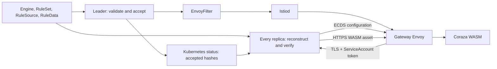

# Native ECDS distribution for Coraza configuration

- **Status:** implemented in CKO commit `e4f5c2c`; follow-up work remains below.
- **Scope:** Coraza Kubernetes Operator (CKO), its WASM consumer, and Istio gateways.
- **Validation target:** upstream Istio on KIND. The recorded demo used Istio 1.31.1; it does not establish OpenShift compatibility or complete HA coverage.

## Decision

CKO delivers each Engine's complete WAF configuration through Envoy's Extension Config Discovery Service (ECDS), rather than through HTTP polling. The elected leader validates rules and records accepted hashes in Kubernetes status. Every operator replica reconstructs accepted configurations, verifies the hashes, and serves its own snapshots.

An EnvoyFilter attaches the WAF to the target Gateway and configures its ECDS subscription. Gateway pods need no new containers, mounts, or rollouts. The default WASM module is bundled with CKO and served as raw HTTPS bytes; Envoy verifies its SHA-256 digest.

The previous HTTP rule server and its helpers remain in the source tree but are not started. `Engine.spec.ruleSetCacheServer` is retained for compatibility and ignored.

### Why ECDS?

The previous plugin polled a process-local cache populated by the leader. A Service could send requests to a follower without that cache, and credential renewal changed plugin configuration. ECDS moves delivery, reconnects, and ACK/NACK handling to Envoy. Rule and data updates no longer require polling or Gateway restarts.

This does not make updates atomic across proxies, make ACKs proof of WAF health, or persist historical rule payloads.

### Scope

The implementation covers rule and RuleData delivery, leader-only acceptance, publication by every replica, ServiceAccount authentication, per-Engine authorization, TLS, bootstrap policy, and a bundled module. It does not add a second active delivery mode, a separate serving deployment, OCI translation, or Gateway pod customization. OpenShift image verification, mixed-release rollover, and full HA testing remain follow-up work.

## Architecture



| Responsibility | Owner |
| --- | --- |
| Validate resources, provision Gateway attachment, write status | Elected leader |
| Assemble rules and render deterministic configuration | Shared assembler and renderer |
| Reconstruct snapshots, authenticate clients, serve ECDS and bundled assets | Every CKO replica |
| Fetch and verify the WASM module | Envoy |
| Build the WAF and inspect requests | WASM plugin |
| Normal Gateway configuration and central telemetry | Istio and the platform |

The leader and publishers use the same assembly and rendering rules. Followers do not approve content or write acceptance status. Leader election is required when running multiple replicas.

## Acceptance and publication

The RuleSet controller assembles RuleSources in `spec.sources` order, merges RuleData in `spec.data` order (later files win), and validates the result with an in-memory filesystem. Aggregate validation and unsupported-rule checks apply even when source-level validation is skipped. Empty rules are rejected unless `RuleSet.spec.emptyRulesPolicy` is explicitly `Allow`.

The leader records the accepted RuleSet content hash and generation. It then renders the Engine configuration, checks delivery limits, provisions the NetworkPolicy and EnvoyFilter, and records the accepted Engine version, RuleSet identity and hash, binary URL and digest, rendering version, generation, and failure policy. A candidate is not served before acceptance. Input changes during acceptance must not produce a mixed, unapproved configuration.

Every replica watches the relevant resources and status, reconstructs the accepted content, and publishes only when the identities and hashes match. For the bundled module, replicas use the resolved URL and digest in accepted status rather than silently substituting their own release default. A mismatch can retain an existing eligible snapshot; it never authorizes current desired content merely because `Ready=True`.

`Ready` means the operator accepted and provisioned the configuration. It does **not** mean that a proxy ACKed it or that traffic is being inspected. ACK/NACKs and runtime health are separate diagnostics.

### Identity and limits

Each Engine instance has one ECDS resource:

```text
coraza.waf.<namespace>.<engine-name>.<engine-uid>
```

The UID prevents a recreated Engine from inheriting its predecessor's resource. A RuleSet shared by multiple Engines produces separate resources.

The RuleSet hash covers rule text and data filenames and bytes. The Engine version covers the effective Engine configuration, including the RuleSet identity and content, policies, observability, module URL and digest, VM settings, and schema versions. Credentials, nonces, timestamps, Kubernetes resource versions, and replica identity are excluded. Identical content can reproduce an older version; versions are not sequence numbers.

The current consumer is the `envoy-coraza` filter from [coraza-rs](https://github.com/networking-incubator/coraza-rs). CKO sends rules and UTF-8 RuleData as versioned JSON wrapped in the consumer's `config_gzip_b64` envelope: one deterministic gzip member (zero header, fixed level) encoded as standard padded base64; module bytes are not embedded in ECDS. The plugin decompresses and rebuilds the WAF, and rejects the envelope combined with any other top-level key. See [Issue #580](https://github.com/networking-incubator/coraza-kubernetes-operator/issues/580). The operator validates both the decompressed configuration against the plugin's 8 MiB cap and the encoded message against the gRPC limit; the encoding is deterministic and carried in the rendering schema version, so different resource bytes never share an ECDS version. See [the parser contract](https://github.com/networking-incubator/coraza-rs/blob/81f0a2b73f53337462368eff590946356e1193bf/envoy-coraza/src/config.rs) and the [operator/plugin contract](../docs/content/reference/ecds-plugin-contract.md). The operator defaults are 16 MiB per gRPC message, 6 MiB of RuleData, and 1024 files. Acceptance and publication check the applicable limits.

## ECDS and recovery

The current implementation serves streaming state-of-the-world ECDS using Envoy v3 `TypedExtensionConfig` resources. Each stream subscribes to one explicit Engine resource; wildcard and multi-resource subscriptions are not supported. Delta ECDS and ADS are not implemented. These are current implementation choices, not permanent exclusions; [issue #579](https://github.com/networking-incubator/coraza-kubernetes-operator/issues/579) tracks stream and RuleData delivery options.

Authorization happens before a snapshot can be returned. Node metadata and the requested resource name are not proof of identity. A missing snapshot must not produce an empty successful response that Envoy could interpret as removal.

Envoy may remember a rejected typed configuration, including after an initial remote-module cache miss. To retry, CKO derives a wire version and VM ID with a `.retryN` suffix without changing the accepted content hash. Resolvable NACKs retry with exponential backoff, starting at two seconds and capped at 30 seconds; there is no attempt or time limit. An ACK clears the stream's retry tracking. A retry does not approve new content or roll back other proxies.

An established proxy retains its working configuration when an update is rejected. A proxy without one uses its bootstrap policy. NACKs are logged and counted, but an Engine-visible condition for persistent rejection remains follow-up work.

## Authentication and authorization

Envoy reads the Gateway pod's projected Kubernetes ServiceAccount token from `/var/run/secrets/kubernetes.io/serviceaccount/token`. Google gRPC uses the `envoy.grpc_credentials.file_based_metadata` factory to read the file for new streams. The operator validates tokens with TokenReview and authorizes each requested Engine against the ServiceAccount used by the target Gateway's actual workload. Workloads sharing a ServiceAccount also share its Engine access.

By default TokenReview uses the API server audience; an explicitly configured audience must match the validated result. Token rotation does not change the ECDS payload or accepted hash. Streams have a bounded lifetime and are periodically revalidated. An explicit TokenReview rejection closes the stream; an API error leaves it open, subject to later revalidation and the stream lifetime limit. New streams can reuse a cached successful authentication until that cache entry expires.

Authorization mappings have a freshness bound, but Engine, Gateway, and Pod reads use the informer cache. An interrupted watch can therefore refresh a mapping from stale data; the bound alone does not guarantee revocation during a watch partition. Verify and strengthen this behavior before claiming that guarantee. A disconnected proxy can still enforce the WAF it already holds.

The standard Kubernetes token mount was observed on an OpenShift Gateway, but that alone does not verify its proxy supports the required credential extension. A supported Gateway image must provide a readable token with an accepted audience without pod-template changes.

ServiceAccount tokens authenticate clients; server TLS protects the connection. The public CA is injected into the Envoy configuration, not mounted into Gateway pods. Tokens and private keys must not appear in ECDS payloads, status, URLs, logs, or metrics.

## Module delivery and trust

The operator serves ECDS and the bundled module on one TLS listener, port `18080` by default. The asset route is `/wasm/<sha256>.wasm` and works over HTTP/1.1 and HTTP/2. It serves only packaged bytes, without an ECDS bearer token. Each replica verifies its embedded manifest and module digest. The developer fixture is not a functional WAF; release and demo builds use real module bytes.

`spec.driver.wasm.url` and `sha256` can instead specify a custom raw HTTPS module; both must be present or both omitted. Envoy fetches the bytes and verifies the digest; CKO does not fetch, cache, or proxy them. Custom hosts currently need a certificate trusted by the operator's xDS CA and TLS 1.3. The binary-fetch cluster does not receive the ECDS token. The URL cannot contain userinfo, a query, or a fragment.

CKO does not enforce a destination allowlist or block private and cluster-internal destinations. Deployments using custom URLs must restrict Gateway egress to approved destinations, including protection against redirects and DNS rebinding. TLS and digest verification do not replace those controls.

The bundled asset is not secret; RuleData is. Rule content stays behind ECDS authentication and authorization. No rule endpoints are exposed by the asset handler.

The current chart can regenerate default certificate material and the attachment CA is loaded at startup. Reusing generated Secrets and coordinating CA rotation with overlapping trust are follow-up work; leaf certificate reload alone is not seamless CA rotation. Mixed-release deployments also need a plan for every ready replica to serve the digests referenced by accepted configurations.

## Attachment and failure policy

The leader creates a Gateway-scoped EnvoyFilter that inserts the HTTP filter before the router, configures Google gRPC for ECDS, and adds a separate HTTPS cluster for module fetches. No WasmPlugin, TrafficExtension, ServiceEntry, or DestinationRule is needed for this path. Istiod remains responsible for ordinary Gateway configuration.

Before the first ECDS configuration arrives, the filter uses a native RBAC bootstrap that requires no WASM download:

| Engine policy | Bootstrap | Effect |
| --- | --- | --- |
| `fail` (default) | `ALLOW` with no policies | Deny traffic |
| `allow` | `DENY` with no policies | Allow traffic |

Bootstrap denial uses HTTP 403; runtime and rule failures may produce different responses. Tightening the bootstrap policy applies immediately; weakening it waits for a matching accepted configuration, then converges asynchronously. Acceptance does not imply fleet-wide activation. Before Istiod delivers the attachment, CKO cannot claim enforcement.

Rule and policy updates do not restart Gateway pods. Existing requests should finish with their original configuration; new requests use the activated configuration. Proxies and workers can temporarily run different accepted versions.

## Availability and failure behavior

Snapshots are local to each replica; Kubernetes stores accepted metadata, not historical payloads. A replica starts publication and serving without waiting for leadership. On cold startup, reconstruction of compatible accepted records gates readiness for up to two minutes. After that, the replica reports unavailable records and can serve other Engines; readiness does not guarantee identical snapshots across replicas.

| Event | Behavior |
| --- | --- |
| Invalid or missing rule input | Reject or wait on the replacement. Established proxies keep their WAF; the accepted record may be retained or cleared depending on the failure. |
| Accepted record is cleared | The replica withdraws its distributable snapshot, not the WAF already held by a proxy. A fresh proxy follows its delivered bootstrap policy. |
| Serving replica or leader fails | Existing proxies keep their configuration; streams reconnect to another ready replica. Reconciliation pauses until a leader is elected. |
| All replicas fail | Existing proxies keep their configuration. A Gateway created during the outage has no operator-provisioned attachment or failure policy until CKO returns. |
| All copies of historical content are lost while inputs are invalid | Hashes cannot reconstruct the old bytes. Existing proxies may retain them; cold replicas and fresh proxies cannot recover them. |
| Token or authorization is revoked | Stop delivery once revocation is detected, including on existing streams. Detection is subject to the revalidation and watch limitations above; an active WAF is not remotely erased. |
| Engine is deleted | Remove its attachment and revoke its subscriptions. A recreated Engine has a new UID. |

Ordinary wait states and aggregate validation failures can retain accepted metadata. Definitive rejection of content that the consumer cannot safely use, a missing or recreated RuleSet, or a delivery-limit rejection can clear it. See [rule processing](../docs/content/explanation/rule-processing.md) for the current condition behavior.

## API migration

The WASM driver change is breaking within `waf.k8s.coraza.io/v1alpha1`: `image` and `imagePullSecret` were replaced by `url` and `sha256`. There is no conversion webhook or compatibility bridge for the polling plugin. The implementation does **not** yet provide legacy-field tombstones or a preflight. Applying the new CRD can prune the old fields, causing an Engine without a new override to select the bundled module silently.

Pre-ECDS WasmPlugin resources are not automatically removed and can remain attached alongside the new filter. Inventory old module references and remove legacy attachments as described in the [upgrade guide](../docs/content/howto/upgrading.md). Explicit rejection of legacy fields and a preflight that isolates affected Engines remain proposed follow-up work.

## Validation and open work

The following are acceptance goals, not a claim that the full campaign has passed:

- Deliver a full CRS ruleset and data within the configured limits; verify rule, data, policy, and binary updates without Gateway restarts.
- Verify hash gating under reordered watches and concurrent edits, invalid inputs, Engine deletion and recreation, and loss of historical payloads.
- Exercise fail-open and fail-closed bootstrap, NACK retries, in-flight requests, VM failures, and repeated updates against real proxy images.
- Test follower and leader failure, cold-start readiness, reconnects, and HA/soak behavior.
- Test bootstrap update ordering across leader crashes and restarts, including policy weakening before and after acceptance.
- Test token rotation, audience and expiry checks, idle stream revalidation, shared identities, revocation, and TokenReview API or watch partitions.
- Verify bundled module fetches without external access, TLS trust and rotation, digest failures, and release rollover across replicas.
- Validate the actual OpenShift proxy image before claiming support; an inspected token mount is not sufficient.

Use unit tests for hashing, rendering, authorization, and stream state; envtest for controllers and status; real Gateway integration and CRS conformance tests for dataplane behavior. A valid protobuf alone does not establish proxy behavior.

Other follow-ups include upgrade preflight/tombstones, certificate reuse and trust rotation, an Engine-visible persistent-NACK signal, and validation of module builds and release artifacts. The earlier prototype review also identified possible `SecDataset` over-rejection and payload-envelope estimation edge cases; re-evaluate these against the current consumer and filename validation before treating them as current defects. The former Go plugin's `@owasp_crs` aliases are not supported by `envoy-coraza`; see the [plugin contract](../docs/content/reference/ecds-plugin-contract.md) for current CRS behavior and limitations.

## Alternatives considered

| Alternative | Reason not selected |
| --- | --- |
| Keep HTTP polling active alongside ECDS | Adds a second delivery and authentication path; the old implementation remains disabled. |
| Put rules in WasmPlugin and let Istiod deliver them | Keeps payloads in Kubernetes extension objects and makes Istiod the serving control plane. |
| Use WasmPlugin only for OCI code and CKO for ECDS | The inspected Istio flow rewrites OCI references on Istiod's ECDS path; direct CKO ECDS bypasses it. No supported handoff was found. |
| Add Gateway containers, mounts, or image volumes | Requires pod customization and potentially rollouts. |
| Add an Istio agent companion or static bearer token | Adds identity machinery, or embeds credentials and makes rotation change configuration. |
| Persist historical payloads | Improves cold recovery but adds a durable store outside this design. |
| Let followers independently approve desired content | Removes the single acceptance authority. |
| Resolve OCI or proxy external modules inside CKO | Adds registry credentials, extraction, and caching; bundled raw bytes meet the default use case. |

## Future decision: separate ECDS serving deployment

A separate read-only publisher could isolate Gateway-reachable serving from the writer. CKO would still validate and accept configurations; the publisher would read inputs and status, verify the same hashes, and serve ECDS and the bundled module. It would need TokenReview permission as well as resource reads, and must preserve the same authorization and last-known-good rules.

Before choosing this split, decide Service and TLS ownership, accepted endpoint metadata, network isolation, RBAC, bundle availability and air-gapped operation, independent rollout compatibility, and whether CKO's own listener is disabled. If Gateways cannot reach CKO, the accepted module URL must also point to a reachable serving endpoint. [Issue #581](https://github.com/networking-incubator/coraza-kubernetes-operator/issues/581) tracks whether this isolation is warranted and the deployment design it would require.

## Future decision: incremental RuleData delivery

Today each Engine is one complete resource, including inline RuleData. A rule-only change retransmits that Engine's unchanged files. The consumer's `config_gzip_b64` form is a lower-complexity way to reduce bytes for compressible payloads, but does not avoid retransmitting the complete resource. Delta xDS updates named resources, not fields within a `TypedExtensionConfig`, so Delta alone would not reduce bytes for an Engine update.

Delta ECDS could still help if a stream later carries several Engine resources: it can send only the changed Engine resource, while SotW sends the current subscribed set. Multi-resource streams could also reduce connection overhead, but require per-resource authorization, revocation, and ACK/NACK handling. Multi-resource streams, Delta, and file-level delivery remain options to evaluate under [issue #579](https://github.com/networking-incubator/coraza-kubernetes-operator/issues/579); payload compression is tracked separately in [issue #580](https://github.com/networking-incubator/coraza-kubernetes-operator/issues/580).

ADS aggregates xDS resource types onto one stream; it does not itself reduce payload size. It may be useful if CKO later serves additional xDS types or needs coordinated stream handling, but is not required for ECDS or RuleData optimization.

A future design could send a manifest of filenames and content hashes, with immutable files fetched only when absent from a cache. Options include authenticated file downloads, separately versioned xDS resources with an explicit consumer, or retaining the current complete payload after measuring its cost. This is the change needed to avoid retransmitting unchanged RuleData within one Engine; Delta ECDS or ADS alone cannot provide file-level incrementality.

Any split must stage and verify the complete file set before building and activating a WAF, retain old content for in-flight requests, define cache lifetime and recovery, bound resource use, and authorize file access per Engine. A content hash is not permission to read tenant RuleData. Measure transfer, CPU, memory, cold starts, and fanout before choosing a protocol.

## Open question: authenticating module downloads

The bundled asset route is unauthenticated and air-gapped. Authenticated private raw-WASM hosts are not supported. An OCI `imagePullSecret` cannot simply be reused: Envoy fetches an HTTPS URL, not an OCI image.

Possible future approaches are client certificates, supported Envoy credential injection, or a platform-owned authenticated mirror. Operator-side fetching or proxying is not selected. Custom hosts already require the egress controls described above; operator-managed destination restrictions and independent CA trust remain follow-up work.

Any credential design must avoid putting secrets in URLs, ECDS payloads, status, EnvoyFilters, logs, or metrics; must not forward ServiceAccount tokens to external hosts; and must not require Gateway pod changes or rollouts. It must preserve TLS and digest verification, avoid anonymous fallback on authentication failure, and rotate credentials without changing the accepted content hash or reloading an unchanged WAF. Secret scope, RBAC, failure reporting, and rotation evidence remain open decisions.

## References

- [ECDS plugin contract](../docs/content/reference/ecds-plugin-contract.md), [Istio integration](../docs/content/explanation/istio-wasm-integration.md), and [operator flags](../docs/content/reference/operator-cli-flags.md)
- [RuleSet assembly](../internal/rulesets/assemble/assemble.go), [Engine rendering](../internal/ecds/render/render.go), [replica publication](../internal/controller/publication_controller.go), and [xDS serving](../internal/xds)
- [Envoy ECDS](https://www.envoyproxy.io/docs/envoy/latest/api-v3/service/extension/v3/config_discovery.proto.html), [xDS protocol](https://www.envoyproxy.io/docs/envoy/latest/api-docs/xds_protocol), and [remote code source](https://github.com/envoyproxy/envoy/blob/v1.38.0/api/envoy/config/core/v3/base.proto#L527-L552)
- [Envoy file-based metadata credentials](https://www.envoyproxy.io/docs/envoy/latest/api-v3/config/grpc_credential/v3/file_based_metadata.proto), [Kubernetes ServiceAccounts](https://kubernetes.io/docs/concepts/security/service-accounts/#authenticating-service-account-credentials), and [TokenReview](https://kubernetes.io/docs/reference/kubernetes-api/definitions/token-review-v1-authentication/)
- [Istio OCI conversion](https://github.com/istio/istio/blob/1.30.3/pkg/wasm/convert.go#L345-L425) and [EnvoyFilter extension handling](https://github.com/istio/istio/blob/1.30.3/pilot/pkg/networking/core/envoyfilter/extension_configuration_patch.go)
